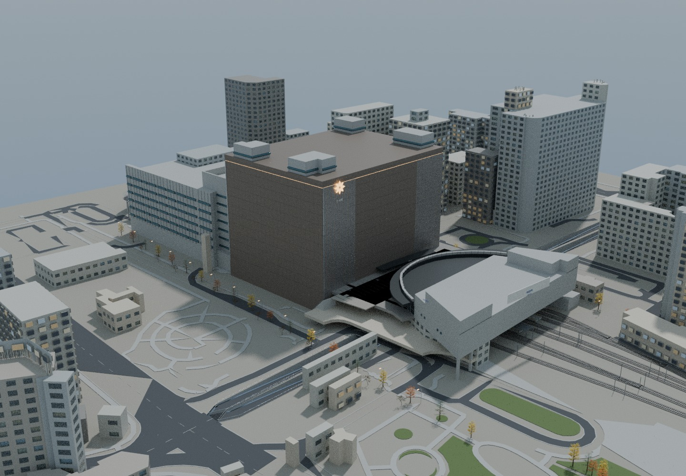

# 의정부 디지털 트윈 개발과정기

> **상태 읽기 안내(2026-11-17 KST 추가):** 아래 초기 문단·12절 체크리스트는 당시의 기록이다. 5차와 도시 타일의 후속 배포는 14절을, v8은 16절을, 이후 로컬 개선과 아직 배포되지 않은 항목은 17절 이후를 참조한다.

> 기록 범위: 2026년 11월 16일 밤~17일 새벽(KST), 1차 착수부터 5차 작업 및 시 전역 윤곽 생성까지. UTC로는 11월 16일에 해당한다. 이 문서는 결과를 완성품으로 포장하는 소개서가 아니라 **자료 → 가설 → 구현 → 실패 관찰 → 수정 → 검증 → 배포**의 과정 기록이다. 작성 시점에 4차는 운영 배포 검증 완료, 5차와 시 전역 확장은 생성·통합·업로드가 진행 중이다.

## 1. 출발점과 계속 바뀐 완료 기준

처음 저장소는 짧은 README만 있는 상태였다. 목표는 의정부역 일대를 Blender로 구현하고 실제 간판과 나무·단풍, 하늘과 최적화를 갖추는 것이었다. 단순 도시 매스가 아니라 사진에 가까운 장소감을 요구했으며, 구현 중에도 사용자는 여러 지점의 렌더를 보고 부족한 점을 계속 지적했다.

이 지적은 부가 요청이 아니라 모델의 구조를 바꾸는 기준이 되었다. 평면적인 도로와 비어 있는 내부, 어두운 유리, 지나치게 단순한 건물을 그대로 두고 객체 수나 테스트 성공만으로 완료를 선언하지 않기로 했다. 요구는 다음 순서로 구체화되었다.

1. 실제 역 주변 사진·지도에 기반한 외관과 무료 수목.
2. 최신 LTS와 실제 무료 에셋 확보, 반복적인 사진 보고.
3. 정적 웹과 `twin.uijeongbu.rhee.life`, GitHub main 연동 자동 배포. GitHub Actions 금지.
4. 별도 내부 보기 금지. 외관 출입구와 대합실을 한 공간으로 연결.
5. 야경·조경, 철도·승강장·전차선, 건물별 창빛과 유리 너머의 내부.
6. 사용자 화면에서 나타난 도로 줄무늬·창 잡점 등 깊이 경쟁 제거.
7. 가로등·가로수·신호등·도로명 표지판, 주변 개별 건물의 외관.
8. 의정부시 전체의 건물·도로·지형 윤곽으로 확장.
9. 개발 과정 자체를 저장소 문서로 기록하고 계속 렌더를 공유.

## 2. 근거를 다루는 원칙

자료의 종류마다 확인할 수 있는 것이 다르다. 지도 좌표는 입면과 현재 간판을 알려주지 않으며, 사진은 보이지 않는 뒷면이나 실제 층고를 확정하지 않는다. 공식 층수도 미터 단위의 높이와 같지 않다. 그래서 아래 구분을 유지한다.

|구분|사용 방식|확정하지 않는 것|
|---|---|---|
|OSM 건물·도로·시설 좌표|외곽선, 중심점, 교차로와 선형의 위치|전수성, 현행성, 측량급 정확도|
|공식 건축·건물 자료|건물 정체, 확인된 층수, 설계 형태|현재 모든 점포와 광고|
|날짜가 있는 방문사진|그 시점의 외장, 창, 출입구, 실내 마감|촬영되지 않은 방과 정확한 치수|
|과거 조경·야경 사진|빛의 성격, 벤치와 식재 유형|지금도 모든 장식물이 존재하는지|
|DEM|도시와 산지의 큰 고저차|지하차도·인도 턱·실내 층고|
|절차적 모델링|창·풀·자갈 등 반복 형상의 효율적 생성|실제 개별 물체의 정확한 수량·배치|

출처 목록과 직접 확인한 사진별 관찰은 [시각·지도 조사](../reference/RESEARCH.md)에 남긴다. 동영상 후보 링크를 찾은 것과 실제 재생하여 본 것은 구분한다. 사진 원본을 모델 참고로 읽은 것과 사진을 텍스처로 재배포한 것도 구분한다.

## 3. 1차: 역·백화점과 주변 윤곽을 세우다

OSM 직접 API에서 확보한 지도와 해안건축 공식 사진, 관광공사 공원 사진을 출발 자료로 삼았다. 높은 백화점과 낮은 역동, 깊은 곡면 캐노피, 외부 계단과 곡선 주차램프를 분리했다. 코레일 의정부역과 경전철 의정부역을 같은 장소로 합치지 않았다.

초기에는 역·백화점 22매스와 주변 약 518개 건물 객체가 만들어졌다. 그러나 이 수는 최종 도시의 건물 전수 숫자가 아니다. 이후 `building=roof` 태그를 일반 건물로 처리한 오류를 발견해 지붕 24건을 제외했고, 주변 건물 수는 494동으로 정정했다. 첫 숫자를 영구적인 성과 수치로 반복하지 않는 이유다.

낮·석양·밤 하늘을 만들고 세 시점의 렌더를 생성했다. 사용자에게 첫 이미지를 보여 주자 “사실적이지 않고 조잡하다”는 피드백이 나왔다. 이 단계는 완성된 사실 재현이 아니라 외곽과 배치를 확인하는 연구 모델이었다. 반복 핀과 창, 단순한 벽, 평면적인 지면이 실제 장소와 다른 점을 드러냈다.

## 4. 무료 수목과 환경의 확인

설치된 Blender 4.3.2에는 등록된 수목 라이브러리가 확인되지 않았다. 처음에는 자체 절차적 은행·단풍·소나무와 두 단계 LOD를 제작했다. 이는 외부에서 받은 무료 나무라고 소개하면 안 되는 자체 제작 자산이다.

사용자의 후속 지시에 따라 공식 Blender 5.2.4 LTS를 별도로 받아 체크섬과 실행을 확인했고, 기존 버전을 덮어쓰지 않았다. 동봉 brush/node 에셋과 온라인 Essentials의 존재도 구분했다. “Blender에는 무료 에셋이 없다”는 일반화 대신, 해당 설치에서 동봉된 수목 메시를 확인하지 못했다는 범위로 설명을 바로잡았다.

Poly Haven의 CC0 `Tree Small 02` 원본과 텍스처 10개를 실제 확보해 MD5를 대조했다. 이를 도시용 공유 메시와 낮은 해상도 텍스처로 정리하고 여름·가을색 파생 자산을 만들었다. 원본 식물은 Burkea africana이며, 가을색 변경은 재질 파생이다. 이것이 의정부 현장에서 확인한 단풍나무 수종이라는 뜻은 아니다.

최종 장면에 무료 외부 자산 12개 공유 인스턴스와 자체 수목이 함께 들어갔다. 원본 메시 복제 대신 공유 데이터와 재질 배치를 사용해 메모리와 객체 처리를 줄였다. 세부 수치·라이선스·재생성은 [수목 기록](TREE_ASSETS.md)을 따른다.

## 5. 2차: 사진에서 드러난 층과 공간의 오류

### 5.1 광장을 막은 가짜 건물

광장 카메라가 검게 가려지는 문제를 렌더로 발견했다. 원인은 지도에 기록된 `building=roof`와 높이 `0.01`을 일반 건물 높이 보정 규칙에 넣어 9.9m 정도의 통박스로 만든 데 있었다. 지붕 태그를 건물 몸체로 생성하지 않도록 분리하고, 잘못 뒤집힌 면법선도 교정했다.

처음에는 광장 높이를 6m로 가정했으나 주변 데크와 연결되지 않았다. 공식 자료로 확인한 것은 대합실이 3층이라는 사실이며, 11m라는 모델 값은 OSM 데크와 사진을 정합하기 위한 추정이다. 6m 가정을 취소하고 더 일관된 연결 기준을 사용했다. 과거 문서의 값은 당시 시도이고 후속 검토가 이를 대체한다.

### 5.2 시민로는 평면 도로가 아니다

2025년 방문 사진에서 중앙 지하차도와 양측 지상도로가 서로 다른 높이임을 확인했다. 실제 OSM tunnel/cutting way를 따라 경사 노면·옹벽·난간과 지면 절개를 만들었다. 지도의 `layer=-2`를 “깊이 2m”로 해석하지 않았다. 최대 깊이 5m는 여전히 사진 기반 근사다.

### 5.3 별도 내부 장면에서 단일 공간으로

사용자는 내부를 별도 보기로 두는 방식을 명확하게 거부했다. 따라서 대합실을 독립 배경처럼 보여 주지 않고 외부 출입구 뒤에 같은 좌표계로 연결했다. 대합실 사진 세 장에서 회색 타일, 금속 격자 천장, 사각등, 유리칸막이, 발권기, 점자블록, 개찰기, 계단과 양측 에스컬레이터를 관찰했다.

내부 첫 검수에서는 가정한 중앙 기둥이 점자 통로를 막고, 에스컬레이터가 바닥에 묻혔다. 기둥을 제거하고 바닥 개구부와 아래층 착지면을 수정했다. 통합 뒤 출입구를 막는 또 다른 OSM 지붕 매스를 raycast로 찾았고 얇은 슬래브로 바꾸어 외부에서 내부가 보이게 했다. 구조가 연결된다는 것과 실제 치수까지 일치한다는 것은 별개이므로 추정 변환과 층고를 문서에 남겼다.

자세한 근거: [2차 검토](V2_REVIEW.md), [내부 연구](INTERIOR.md).

## 6. 3차: 빛과 식재의 밀도를 만들다

야경에서는 백화점 코너의 차가운 루버빛과 캐노피·지하차도의 따뜻한 빛을 사진에서 구분했다. 처음 너무 어두운 야경은 보조광을 조절해 다시 렌더했다. OSM 잔디 구역 36개와 크기·색을 달리한 개별 풀잎을 추가하고 네 개 메시로 묶었다.

2018년 공원 사진에서 바닥 매입등, 원형광장 둘레 조명, 벤치·식재와 안내도를 확인했다. 과거 LED 장미나 장식물을 현재 존재하는 시설로 단정해 무작정 배치하지 않았다. 실내 대합실 사진에서는 정원·화분을 확인하지 못했으므로 “실제 내부 조경”을 지어내지는 않았다.

조명 에너지와 창의 점등은 실측값이 아니라 시각적 근사다. Blender의 area/point light가 GLB에 그대로 들어가는 것은 아니므로 웹에서의 야간 표현은 별도로 검증해야 한다. [야경·조경 기록](NIGHT_LANDSCAPE.md)에 이 차이를 명시했다.

## 7. 4차: 사용자 화면이 드러낸 깊이 경쟁

사용자가 보낸 웹 화면에는 교차로의 회백색 줄무늬와 건물 창의 검은 점이 있었다. 이는 낮은 Cycles 샘플에서 생기는 렌더 노이즈와 다르게, 도로 조각의 공면 중복과 웹 깊이 정밀도·압축 좌표 정밀도를 함께 의심해야 하는 증상이었다.

1. 원본 도로 ribbon을 단순히 여러 번 덮지 않고 평면 합집합·차집합으로 도로/보행로/연석을 분리했다.
2. 도로 표면 간 수평 겹침을 수치 검증해 약 `1.1e-15㎡` 수준으로 줄였다. 이는 해당 계산의 부동소수점 오차 수준이며 모든 장면의 모든 오류가 0이라는 뜻은 아니다.
3. Draco 위치 정밀도를 20bit로 높여 도심 전체 범위에서 얇은 창 구조가 양자화로 무너지지 않도록 했다.
4. 웹의 near/far 범위를 카메라 거리에 맞게 조절하고 reversed depth 우선·log depth fallback을 추가했다.
5. 창을 벽 앞 발광판으로 겹쳐 붙이는 대신 벽에 구멍을 내고 두께 있는 유리와 얕은 내부 공간을 만들었다.

324개 주변 건물에 창 16,459개를 생성했으며 7,263개를 야간 점등 대상으로 구성했다. 이는 실제 각 방의 위치와 점등을 조사한 결과가 아니라 불규칙 창빛을 표현하는 절차적 모델 수치다. GLB는 단일 scene을 유지했다.

철도는 실제 지도 선형을 사용해 105개 구간과 5,872개 침목을 만들었다. 여섯 플랫폼 태그를 여섯 개 섬으로 중복 해석하지 않고 세 개 섬식 영역으로 결합했다. 전철과 교외선, 경전철을 구분하며 높이·캐노피·전차선 간격은 추정으로 남겼다.

검증 파일은 [4차 통계](v4-validation.json), [깊이와 창 개선](V4_DEPTH_AND_WINDOWS.md), [철도 기록](RAIL_NOTES.md), [창빛 기록](WINDOW_LIGHTING.md)에 있다. 낮/밤/입구/철도 렌더는 다음과 같다.

## 8. 파일 전송과 배포도 검증 대상이다

큰 파일을 만들었다는 것과 저장소·운영 사이트에 반영되었다는 것은 다르다. 약 10.8MB GLB의 GitHub blob 전송이 741초 동안 응답하지 않아 중단되었고, 불변 사본의 해시를 확인한 후 다른 전송 경로로 성공했다. 사용자 승인 버튼 미클릭이 원인이었다고 확인한 것은 아니다.

4차 `.blend`는 기본 압축 18,335,088바이트에서 Zstandard level19로 10,645,347바이트로 줄였다. 해제한 전체 바이트의 SHA256가 동일했고 Blender 재열기도 통과했다. 파일 용량을 줄이기 위해 형상이나 텍스처를 삭제한 것이 아니다.

Cloudflare native Git Builds를 main에 연결하고 GitHub Actions를 만들지 않았다. 도메인 HTTP 200만으로 3D가 정상이라고 판단하지 않았다. `build.json`의 커밋과 운영 GLB의 해시·바이트 수, 단일 scene 및 대합실·철도 노드까지 확인했다.

또한 `station.glb`라는 고정 이름 때문에 브라우저가 이전 파일을 최대 한 시간 재사용하는 문제가 있었다. 배포마다 콘텐츠 해시가 들어간 모델 파일명을 생성하도록 바꾸어 새 파일을 요청하게 했다. 임시 뷰어와 Git 정적 자산 간 덮어쓰기 충돌도 Git 기반 자산으로 통합해 해결했다.

### 확인된 원격 이정표

|단계|main 커밋|기록 의미|
|---|---|---|
|1차|`9c1e4e809adcc326c7bd46a069e6d6171f035f27`|첫 외관 연구 모델, 두 부모 병합|
|2차|`2b7375a`|내외관 연결 및 지붕 가림 개선|
|3차|`f100aa7`|잔디와 야경 개선|
|웹 깊이 수정|`ebc6e08`|깊이버퍼·카메라·창빛 전환 및 캐시 대응|
|4차|`dabfadeeddb175f0a1529d4fe27b62b9f428454b`|철도·창 내부·도로 합집합 모델과 렌더 통합|

4차 실배포는 `build.json`과 main이 일치했고 `/assets/station.bdefff8f043aa1ec.glb`를 내려받아 10,783,996바이트, Git blob `1bfdc54acb6f02b397481149e4cecb7af1e4d250`과 일치함을 확인했다. 이 표는 이후 커밋이 생기더라도 당시 검증 이력을 보존한다.

클라우드 브라우저의 WebGL 비활성화와 로컬 Chromium의 socket 제한 때문에 GPU로 웹 장면을 직접 조작하는 시각 검수는 미완료였다. Cloudflare Browser Rendering도 해당 시점 할당량 제한을 반환했다. 따라서 “파일 배포 검증 완료”와 “웹의 깜빡임이 모든 기기에서 완치”를 동일하게 쓰지 않는다.

## 9. 5차: 개별 건물과 거리의 특징을 되살리다

5차는 같은 창 패턴을 모든 건물에 붙이는 것에서 벗어나 특정 사진과 주소를 대조하는 단계다.

- **역동**: 2025년 사진에서 동쪽의 흰 타일 폐쇄면과 북쪽의 긴 창띠를 구분하고, 타일 줄눈·역명판을 보강했다.
- **한화생명 사옥**: 공식 주소와 임대 자료로 특정 OSM footprint를 교차 확인했다. 공식 10층을 채택하고 갈색 커튼월, 검은 상부 띠, 확인된 옥상 글자를 별도 구현했다. 기존 공통 창과 중복 표면을 제거한다. 전체 뒤면과 실별 점등은 아직 근사다.
- **철도 바닥**: 절차적 자갈과 받침판을 추가했다. 이는 사진 자산이나 실측 체결장치가 아니라 생성한 디테일이다. UV 이미지 재질로 만들어 GLB에서도 재현되도록 했다.
- **가로시설**: OSM 가로등 28개, 신호기 노드 2개, 신호횡단 8곳, 나무 주변 그레이팅 35개를 근거 위치에 두었다. 시민로·평화로·신흥로는 지도에서 읽은 이름이고 표지의 정확한 설치 위치와 암 방향·치수는 추정이다.
- **반복 적용 검증**: 가로시설 모듈은 두 번 실행해도 같은 객체 수가 유지되도록 했다. 렌즈·표지 글자·그레이팅은 본체와 깊이를 분리해 공면 경쟁을 피한다.

[한화 외관](HANWHA_FACADE.md), [가로시설](STREET_FURNITURE.md), [5차 생성 검사](v5-validation.json)를 함께 읽는다. 5차 통합 장면은 1,790객체이며 역 타일 969개, 자갈 24,821개와 받침판 11,744개의 생성 디테일을 포함한다. 낮·밤·철도·역 타일 근접 렌더를 각각 검수했다. 작성 시점 작업 브랜치 `feat/photo-details-v5`의 `c28e6f8`까지 코드 마이크로커밋이 확인되었으며 이후 자산 업로드가 진행 중이다. 독립 모듈의 렌더 성공을 운영 배포 성공으로 확대하지 않는다.

### 5차에서 드러난 업로드 한도와 무손실 복원

5차 Blender 파일은 14,449,268바이트다. 단일 blob 요청은 실제로 HTTP 400과 요청 본문 16MiB 한도 오류를 반환했다. 원본 바이너리는 한도보다 작아 보여도 base64 인코딩 후 요청이 커진다는 점이 병목이었다. 이 경우는 앞서 원인 미확인이었던 장시간 무응답과 달리 오류 응답으로 한도를 확인했다.

형상을 깎거나 정밀도를 낮추는 대신 두 조각으로 나누어 업로드하고, `blender/v5/restore.py`가 조각별 해시와 합친 파일 해시를 검증하도록 했다. 복원된 Blender 파일의 SHA256는 `23e956af7c4e78bfdaef413893a7331b582537aa389791c80434c6185d762521`이다. 기존 루트의 4차 Blender 파일은 그대로 두고 최신 5차의 위치와 복원 방법을 별도로 안내한다.

웹 GLB는 14,548,736바이트에서 gzip 8,115,543바이트로 무손실 압축해 전달하고, 웹 빌드 단계에서 다시 푼다. `npm run build` 후 복원 GLB의 SHA256 `fde1fd20970937032f92c31d6a4b0fff40db4f52aad43a8b83826e8478d4e696`이 원본과 같음을 확인했다. 저장·전송 형식과 런타임 형식을 구분한 해결이다. 이 시점의 성공은 파일 업로드와 로컬 빌드 검증이며, 최종 main 병합과 운영 자산의 재다운로드 검증은 별도 단계다.

## 10. 의정부시 전체 윤곽으로 확장

역 주변 상세만으로는 시 전체를 조망할 수 없다는 요청에 따라, 행정경계 relation `2409183`과 실제 고도 데이터를 확보했다. 한 번의 지도 API 요청은 노드 한도에 걸려 20개 구역으로 나누어 받고 way ID로 중복 제거했다.

생성 manifest의 첫 확인 수치는 건물 9,094개, 도로 9,721개 OSM way, 지형 12,759개 셀, 268개 타일·레이어 배치다. 건물 높이 직접 태그는 1,910개이며 나머지 7,184개는 층수 또는 용도별 기본값을 사용한다. “9,721개 도로”는 서로 다른 도로명 9,721개를 뜻하지 않는다.

원점은 역 장면과 같은 경도 127.046, 위도 37.738, 동쪽 x/북쪽 y이다. 지형은 Tilezen/Mapzen Terrain Tiles의 HGT를 80m 메시로 재샘플링했다. 산악 지형과 도시 전체의 큰 높낮이를 위한 것이며 지표 턱이나 역 층고의 측량자료가 아니다. 기존 역 상세 부지는 중복 생성하지 않고 비워 두었다. 중앙의 사각 빈 영역은 결합 자리이지 조사에서 빠뜨린 도심으로 숨기려는 것이 아니다.

첫 컬러 검수에서 도로가 지형에 묻힌 부분을 발견했다. 입력 고도 샘플과 80m 삼각 지형의 보간이 달라 생긴 문제여서, 도로 높이를 렌더 지형의 삼각 보간 기준으로 다시 맞추고 0.65m 시각 오프셋을 주는 수정을 완료했다. 최신 컬러 렌더에서 도로가 이어지는 것을 확인했다. 이 오프셋은 실제 도로가 지면보다 항상 0.65m 높다는 뜻이 아니다. 타일은 1km·레이어별로 나누고 원경에는 윤곽 모델을, 역 근처에는 상세 모델을 사용한다. 모든 타일을 최초 접속 때 한꺼번에 불러오지 않는 방향으로 웹 최적화를 설계한다.

이 단계는 **행정경계 안에 기록된 지도 기반 도시 윤곽**이다. 누락된 건물은 나타나지 않고, 행정경계는 객체 중심 분류라 지적도 수준 절단과 다르며, 고가도로의 모든 층 관계도 아직 구현하지 않았다. 작성 시점 104개의 GLB 타일, 합계 약 4MB를 내보냈다. 전체 윤곽은 로컬 생성·렌더 및 타일 내보내기 단계이며 역 상세와의 웹 통합·배포 완료로 기록하지 않는다.

## 11. 최적화에서 지킨 것과 아직 측정하지 않은 것

시각 개선과 최적화는 서로 반대가 아니라 표현 방식의 문제였다. 반복되는 형상을 재질별 배치로 묶고, 나무는 메시를 공유하며, 보이지 않는 파일 복제와 불필요한 객체 처리를 줄였다. 대량 오브젝트 삭제 병목은 개별 삭제 대신 일괄 처리로 바꿨다.

초기 장면은 12,779객체에서 2,076객체로 줄었고, 이후 조경을 더한 장면은 2,375객체, 4차는 1,754객체였다. 단계마다 기능과 geometry가 다르므로 이 숫자는 동일 장면 FPS 비교가 아니다. 4차 GLB는 1개 scene, 1,645노드, 1,564메시였고 Blender 객체 수와 GLB 메시 수를 혼용하지 않는다.

입체 방과 창·철도 디테일을 추가하면 파일이 커질 수 있다. 작은 파일이라는 이유만으로 필요한 형상을 삭제하지 않고 먼저 무손실 압축과 배치·공유를 사용한다. 실측하지 않은 FPS, 모바일 프레임시간, 메모리 수치를 좋은 숫자로 지어 쓰지 않는다.

## 12. 다음 완료 기준과 남은 일

- [x] 원본 사진과 지도 출처를 남기고 사실/추정을 구분한다.
- [x] 내외관을 한 scene으로 연결하고 출입구 시야를 렌더로 확인한다.
- [x] 4차 모델의 main no-ff와 native Cloudflare 자동 배포, 운영 파일 해시를 확인한다.
- [x] 도로 표면 중복을 수치 계산으로 줄이고 렌더에서 이전 줄무늬 개선을 확인한다.
- [ ] 다양한 실제 GPU·모바일 환경에서 움직이며 깊이 경쟁·투명 정렬을 검증한다.
- [ ] 5차와 시 전체 타일의 최종 main/운영 반영을 각각 확인한다.
- [ ] 현행 간판 전수, 주변 건물 개별 외장과 치수, 역사 내부의 전체 배치를 더 확인한다.
- [ ] 역 상세 지면과 광역 DEM의 경계, 고가도로 층 관계, 도로 침수·매몰·떠 있음 문제를 더 검수한다.
- [ ] 광원·내부 공간·도로시설의 실제 배치와 시각적 근사를 구분하면서 정교하게 만든다.

## 13. 기록을 계속 갱신하는 방법

새 단계는 `요청/근거 → 변경 → 발견한 오류 → 검증 → 커밋 → 배포 → 남은 점` 순서로 추가한다. 이전 실패와 가정은 삭제하지 않고 후속 수정이 무엇을 대체했는지 적는다. 모델러의 검사 결과, 실제 렌더, 원격 파일 해시, 운영 접속 결과는 서로 다른 증거로 보존한다. 사진 보고는 진척을 보여 주는 수단이며 정확도를 과장하는 장식이 아니다.

개발은 계속된다. 현재까지의 성과는 장소를 닮은 장면을 재현 가능한 코드와 자료로 바꾸어 가는 과정이며, 아직 조잡한 부분을 정확히 발견하고 고치는 것 자체가 핵심 작업이다.

## 14. 5차 실배포와 6차 도시 윤곽 스트리밍

5차는 `c936240bf64c7efa5b01dcb7f7a334024f55e845`에서 main으로 병합했다. 운영 도메인의 `build.json`이 동일 커밋을 보고했고, 실제 내려받은 `station.fde1fd2097093703.glb`는 14,548,736바이트 및 SHA256 `fde1fd20970937032f92c31d6a4b0fff40db4f52aad43a8b83826e8478d4e696`로 로컬 원본과 일치했다. 이는 gzip 보관→Cloudflare 네이티브 빌드 복원→콘텐츠 해시 URL 배포가 실제 동작했다는 증거이다. 루트 Blender는 v4 호환본이고 최신 v5는 `blender/v5/restore.py`가 분할 보존본을 검증해 복원한다.

6차는 역 모델을 다른 화면으로 바꾸는 것이 아니라 동일 좌표계에 도시 윤곽 타일을 덧붙이는 방식이다. 지상 시점은 가까운 32~48개 타일만 유지하고, 높은 도시 조망에서는 전체 타일을 순차 로드한다. 동시 디코딩은 두 개로 제한하며 범위를 벗어난 geometry/material을 해제한다. 외곽 타일에는 사진 질감·실제 간판·개별 외장이 없으므로 정밀 역 모델과 구분해 '윤곽'으로 표시했다. 104개 타일은 약4MB로 전체를 단일 거대 GLB로 다시 만들지 않았다.

QA 중 요청시 렌더와 350ms 갱신 제한을 함께 쓰면 사용자가 짧게 이동하고 멈췄을 때 마지막 타일 선택이 갱신되지 않는 문제가 발견됐다. 거리 계산은 104개뿐이므로 시간 제한을 제거하고 렌더 시점마다 평가하도록 고쳤다. WebGL 생성 실패 뒤 도시 보기 버튼을 눌렀을 때의 null 접근도 막았다. 순간 네트워크 오류가 영구 실패로 남지 않도록 2초·4초 백오프와 총3회 한도를 추가했다. 모의 로더 시험은 동시 요청2개 이하, 지상 거주 상한, 이동 후 dispose, 높은 조망 전체 로드를 확인했다. 이는 실제 모바일 GPU의 프레임레이트 측정과는 다르다.

통합 Blender 렌더를 별도로 생성하여 역과 외곽 윤곽이 같은 공간에 놓이는지 직접 확인했다. 이 과정에서 80m 지형 셀의 중심점만으로 역 영역을 제외하면 경계에 수십 미터 겹침/공백이 생길 수 있음을 발견했다. 정확한 역 경계 사각형으로 지형·도로를 잘라내는 후속 보정을 진행한다. 정밀 지면과 SRTM 고도 사이의 150m 전이는 실측 지형이 아닌 연결 근사이며, 도시 도로의 고가·지하 층 분리는 아직 별도 과제다.

브라우저 시험 환경은 GL_VENDOR/RENDERER가 Disabled로 노출되어 실제 WebGL GPU 렌더가 불가능했다. 대체 이미지와 실패 상태 처리는 확인했으나 실제 기기에서의 GPU 미관 검증 완료라고 기록하지 않는다. 이후 운영 반영은 main 커밋, build.json, 타일 원본 해시를 별도로 검증해 기록한다.

타일 업로드104회는 연결 도구 지연 때문에 비효율적이었다. 런타임 pack/Range 로더를 추가하는 대신, USTAR+gzip 아카이브 하나를 보관하고 기존 Cloudflare 빌드에서104개의 독립 GLB를 복원하도록 했다. 이는 런타임 서버 Range 지원 여부에 의존하지 않으며 경로허용목록·GLB헤더·manifest길이·SHA를 빌드시검증한다. 실제 타일 AABB가 격자중심에서2.5km까지 늘어나는 예도 발견하여 고정800m여유 대신 실제외접반경을 로드범위에 사용하도록 수정했다.

경계 검수는 선언된 crop 숫자만 믿지 않았다. 기존 역 모델 생성기를 다시 확인하니 바닥 박스는 중심(45,55), 크기660×610m로 실제 범위가 x[-285,375], y[-250,360]였다. 도로·건물crop보다20~25m넓으므로 도시 지형을 이전crop만큼만 빼면 공면 경쟁이 남는다. 지형 제외범위를 실제 바닥 범위로 분리하고 도로·건물의 지도crop은 기존대로 유지하도록 수정했다. 바닥/지도/타일 경계는 같은 값이라고 가정하지 않는 것이 핵심이었다.

### 6차 운영 확인 마감

`48d6946f2a189a6acaf984d4b70f4d45f9093551`에서 main no-ff 병합했다. Cloudflare의 push_event/main 네이티브 빌드는 success였고, 실 도메인의 build.json도 동일 커밋이었다. 운영 manifest SHA256은 `ba97461940058ceb7e55d8e5e30ee282961260ad00e098eac26b9d4cf28454f3`로 로컬과 같았다. 총3,988,628바이트의104개 타일을 전부 실제 내려받아 각각 manifest SHA와 일치함을 확인했다. 첫 검사24개는 연결 타임아웃이었으며 동시성을8에서4로낮춘재시도에서104/104완료·실패0이되었다. 이것을모델파일오류로오인하지않고전송장애와해시검증을구분했다.

다음 모델 갱신 때 구버전 타일이 브라우저 캐시에 남지 않도록 manifest는 재검증 요청하고, 각 타일 URL에는 해당 SHA256의 앞16자를 버전 쿼리로 붙인다. 도시 Blender 원본과 OSM 원자료 아카이브도 저장소에 보존했다. 실제 GPU 프레임레이트·모바일 미관 검수와 최신 상가 외관 완성은 여전히 별도 과제로 남는다.

## 15. 7차 서부 접근 구조와 떠 있는 면 보수

2025년 서부광장 사진과 OSM 770806011/14/15/18/19/21/22를 대조하여 서남·북측 하부 접근과 상부 접근, 중간참, 가는 회녹색 골조, 유리 캐노피·난간을 구성했다. 정확한 위치를 확인하지 못한 택시쉼터와 포켓쉼터 가구는 사진이 있다는 이유만으로 임의 배치하지 않았다. 계단 수 태그와 방향은 자료 기반이지만, 6.72/11m 높이와 폭은 근사로 기록했다.

첫 검수에서 기존에 대략 배치했던 서측 직선 계단이 새 접근과 중복되어 공중에 남았다. 이름이 있는 객체를 지워도 기존 재질 batch에 포함된 계단 면은 남았기 때문에, 원생성 코드의 x=-49 계단 범위에 완전히 들어간 면만 골라 제거했다. 관련 없는 건물 전체나 보행면을 지우지는 않았다. 새 부품 269개는 재질별 5개 batch로 합치고 법선·유리 두께를 보강해 웹 부하를 줄였다.

종이 쐐기처럼 보이는 지면도 별도로 검사했다. 서측 1,676개 수평면 중 5개 planar ring이 퇴화해 있었다. 기존 도로·보도는 높이만 있는 평면이라 가장자리가 공중 카드처럼 보이는 문제도 있었다. XY 지도 윤곽은 유지한 채 중복 정점과 극소면을 정리하고, 경계에 지면까지 이어지는 수직 측면을 넣었다. 이후 1,665개 서측 수평면 검사에서 invalid ring 0개를 확인했다. 원래 데이터에 있는 각진 윤곽까지 사진과 같아졌다는 뜻은 아니다.

기존 광장 가로등 또한 11m 데크에 대해 기둥이 6~11m로 기록되어 데크 아래에 매달린 것을 원코드에서 확인했다. 동일한 XY 위치를 유지하고 데크 위 11.05~15.05m로 수정했다. 조명 높이는 사진 정밀 측량이 아니라 현재 데크에 대한 구조 정합 근사이다. 처음 선택한 카메라가 주변 건물 속에 들어가 검은 렌더를 만든 실패는 실제 이미지를 열어 확인했다. 가림을 없애기 위해 건물을 지우지 않고 검증된 서측 카메라로 이동했다.

### 7차 원격 반영과 남은 검증

main `937b1ed7`에서 GitHub Actions 없이 Cloudflare 네이티브 빌드 성공을 확인했다. 실제 도메인의 14,655,520바이트 모델을 다시 다운로드했고 SHA256 `58120faaf7f52baf7a3b954202ab6a6cb144f92196bb4db60ee943c5ad481fd9`가 원본과 같았다. 최신 Blender는 `blender/v7`의 두 파트를 복원하는 방식이며 재열기 1,793개 오브젝트 검사를 통과했다.

서부 검사 영역의 불량 평면 링은 5개에서 0개로 줄었다. 다만 전체 도로 검사에서 동쪽 x=201.76..236.70에 수직 경계면 1쌍 중복이 남은 것을 정확히 찾았다. 면적 약 3.63㎡이며 이번 서부 접근 렌더 범위와 별개다. 다음 미세 수정 대상으로 남기며 전체 공면 오류가 0이라고 보고하지 않는다. 주변 일반 건물의 외관은 아직 단순화되어 있고 정확한 위치가 확인되지 않은 택시쉼터와 포켓 가구는 임의로 놓지 않았다. 브라우저 GPU가 비활성화된 검사 환경이라 실제 GPU 프레임률 검증은 수행했다고 주장하지 않는다.

### 7차 경계면 후속 수정

동쪽 아스팔트의 동일 정점 집합 수직 경계면 한 장(약 3.63㎡)만 제거했다. 고유 도로 면이나 XY 윤곽은 변경하지 않았다. 저장 후 Blender를 다시 열어 전체 Union surface 객체에서 동일 정점 집합 중복을 재검사했고 0개였다. 이 검사는 다른 객체 사이의 모든 가능한 겹침이나 시각적 오류가 전부 없다는 뜻은 아니다. GLB를 다시 내보내고 Blender 원본 분할 해시도 갱신했다.

## 16. 서측 사진의 구조적 세부를 반영한 8차 개선

2014년 진입구 사진과 2025년 서측 넓은 사진을 다시 대조했다. 7차에서는 진입 지붕이 처음부터 경사였고 횡방향 프레임만 존재했으나, 실제 사진에는 낮은 입구의 수평 유리 처마와 원형 주기둥, 지붕 세로 격자가 보인다. 이를 기존 OSM 기반 접근 위치 위에 보강했다. 새 시설 위치를 임의로 만들지 않았다. 닫힌 경사 석재 측벽과 줄눈을 추가했고 123개 제작 객체를 4개 재질 메시로 합쳤다. 유리는 두께 12mm 모델링 근사로 보강했고 법선을 재계산했다.

같은 비교 카메라에서 낮과 밤을 직접 렌더하고 검수했다. 사진에 보이지 않는 택시쉼터의 위치나 가구를 추정 배치하지 않았다. 2014년 사진의 세부 재질이 현재도 완전히 같다는 사실은 확인하지 않았고, 2025년 전체 사진에서 확인되는 구조 연속성과 구별해 기록했다.

### 창이 벽 밖으로 튀어나오던 두 가지 원인

동쪽 비교 렌더에서 창과 실내 박스가 벽 밖으로 돌출된 것을 직접 확인했다. 원인은 단순 재질 문제가 아니었다. OSM 외곽선의 시계·반시계 방향이 혼재해 일부 건물의 법선이 안쪽을 향했고, 동일한 -0.9m 방 깊이 적용이 실외로 향했다. 493개 footprint를 확인하고 그중 220개의 방향을 교정했다.

1차 교정 후에도 중앙 건물 일부가 돌출되어 다시 검수했다. 폭 약 0.01~0.2m인 얇은 건물 조각에 0.9m 방을 무조건 생성해 반대편 벽을 뚫는 별도 원인이 있었다. 셀별 세 지점에서 footprint 안쪽 두께를 확인해 그 45% 이하로 깊이를 제한하고, 너무 얇은 36개 셀에서는 벽을 보존하고 가짜 방을 만들지 않게 했다. 건물 전체 삭제나 색 덮기로 감추지 않았다.

결과는 319개 건물의 16,135개 절차적 창이다. 이전 16,459개 통계에는 이미 별도 외관으로 바뀐 한화생명 288개 창이 남아 있었기 때문에 숫자 차이를 단순 누락으로 해석하면 안 된다. 한화생명 개별 외관은 보존했다. 비교 렌더에서 중앙과 우측 돌출이 사라진 것을 확인했으나 실제 창 위치·방 배치·점등 현황을 측량했다는 뜻은 아니다. 새 빌드도 수정 생성기를 호출하도록 연결해 재발을 방지했다.

## 17. 2026-11-17 KST: 현장 사진 재대조, 복구, 그리고 배포 상태의 분리

### 문제를 먼저 정의하다
사용자는 조잡한 윤곽이 아니라 사진으로 확인되는 실제 역사와 주변을 요구했다. 테스트 통과나 객체 수만으로 사실성을 증명할 수 없다. 따라서 최근 방문 사진의 촬영 시각, 설계사 준공 자료, 모델의 면 좌표와 렌더를 서로 대조하고, 추정한 치수와 관찰한 형상을 구분했다.

[2026-06-01 현장 자료](https://hhk2001.tistory.com/8062)에서 10장, [2026-06-23 현장 자료](https://hhk2001.tistory.com/8063)에서 55장을 직접 시각 검토했다. 후자의 8장은 다운로드 타임아웃으로 미검토했다. 6월 사진은 현재 11월 상태를 보증하지 않는다. 자료 확보 수를 전수 재현 완료 수로 바꾸어 쓰지 않는다.

### 업로드 정체와 재현 가능한 복구
8.5MB 압축 모델을 처리하는 과정이 장시간 정체되었다. GitHub 수신 단계인지, 로컬 base64 합성 단계인지 당시 확정할 수 없었으므로 GitHub 장애로 단정하지 않았다. 작은 조각으로 나누고 각 단계 결과를 확인하는 방향으로 바꿨다. 이후 작업 환경에서 로컬 파일이 사라져 원격 v8 분할 보존본과 manifest를 다시 받아 14,581,076바이트 Blender 파일을 복원하고 SHA를 대조했다. 구버전 Blender가 파일을 열지 못해 공식 5.2.4 배포본을 받고 아카이브 해시를 검증했다. 원격 v9 스크립트를 적용하여 표면·UV 38개 객체를 복구했고 추가 폴리곤은 0이었다.

### 현장 대조가 코드 수정으로 이어진 경로
광장 띠가 지표면 위로 75mm 돌출된 것은 사진의 평면 포장과 달랐다. 30개 띠를 매립 형태로 바꿨다. 입구 근접 렌더에서는 검은 겹침이 보였으며 상세 바닥과 OSM 지붕이 같은 Z=11에 놓인 것을 확인했다. 원형 메스를 삭제하는 대신 해당 지붕 정점 33개를 25mm 내려 중복 표면을 분리했다. 이 수치는 실제 현장의 단차가 아니라 렌더링 중첩을 해결하는 모델 보정값이다.

작은 파란 간판, 금속 경사 후드, 양옆 패널, 행거와 110 표식, 출입문 손잡이·레일·안전띠·점자블록을 단계적으로 보완했다. 코레일체는 공식 현재판과 구형 파일을 비교한 뒤 구형 v1.01을 역명 3곳에 적용하고 메시로 변환했다. 원본 폰트 파일은 배포 모델에 포함하지 않았다. 실제 현장 간판의 세부판까지 확정한 것은 아니다. [공식 코레일체 안내](https://info.korail.com/info/contents.do?key=721).

### 현재 원격 상태와 보존 상태
이번 기록 작성 직전 원격 main은 v8 `9e3b4decc59a26a22dbff64363a2567c84eaa7fe`이며 v9 브랜치에는 표면 스크립트 한 커밋이 있었다. 이후 개선 Blender와 렌더는 Library에 보존됐으나 원격 모델 교체와 운영 배포는 아직 이루어지지 않았다. 이 문서·재현 코드의 병합은 모델 전체의 최신 배포 완료를 뜻하지 않는다. GitHub Actions는 사용하지 않는다.

## 18. 고도 데이터: 문제 정의에서 다음 행동까지

지표면 해발고도, 건축물 상대높이, 철도·보행데크 레벨은 서로 다른 데이터다. 도시 윤곽 단계에서 사용한 SRTM과 80m 렌더 지형은 넓은 지형 연결용이며 계단, 지하차도, 인도 턱을 해결하지 않는다. 이전 작업에서 도로가 지형에 묻혀 삼각형 보간 기준으로 높이를 다시 맞추고 0.65m 시각 오프셋을 준 과정도 이 한계에서 비롯됐다. 지형 경계 150m 전이는 실측값이 아닌 접합 근사다.

이번 추가 작업은 새 DEM 확보가 아니라 모델 좌표의 검증이다. OSM 명칭 객체의 세계좌표 바운딩 박스·정점을 출력하고, 설계사 자료와 2025년 전경을 비교했다. 상대 Z=10~22m, 21.5~28m는 기존 모델 수치이지 공식 표고점이 아니다. 사진상 상단이 연속으로 보여도 이를 근거 없이 28m로 올리지 않았다.

다음 확보 행동은 (1) 지리 좌표계와 수직 기준을 명시하고 (2) 국토지리정보원 수치지형도·DEM의 이용 가능한 범위와 해상도, 기준면을 확인하고 (3) 기준점과 공식 건축물 높이 자료를 대조하며 (4) 같은 좌표계로 변환한 뒤 역·도로·선로 단면을 검사하는 순서다. 이 목록은 계획이며 아직 새 공식 DEM 다운로드·좌표계 변환·GNSS 측량을 완료한 것이 아니다. 확인된 자료를 얻기 전에는 높이 추정 플래그를 유지한다.

## 상세 작업 기록: 천장 매입등

## 출입구 사진 대조: 임시 표면등을 실제 개구부가 있는 매입등으로 교체

### 관찰 근거
출처: https://hhk2001.tistory.com/8063 (확보한 출입구 사진).
사진에서 천장의 금속판 분할, 소형 원형등, 후드와 천장이 만나는 높이, 한글 대비 작은 영문 역명을 대조하였다. 새 현장 실측은 수행하지 않았다.

### 앞선 구현의 결함
v10의 원형등은 금속 원통·검은 원통·발광 원판을 천장 아래에 놓은 형태였다. 매입등처럼 보이기 위한 표현이었지만, 실제로는 확산판이 천장보다 내려와 있었다. 이를 매입구조 완성으로 설명하면 부정확하다. 또한 등 위치가 패널 이음선에 걸렸으며, 상부 후드가 천장 슬래브와 교차해 일부가 가려졌다.

### 이번 수정
1. 임시 천장/조명 3메시만 제거하고 같은 범위에 새 3메시를 작성했다. 다른 1,835개 객체는 유지했다.
2. 조명 15개 위치를 패널 내부로 옮겼다.
3. 해당 패널에 지름 0.20m의 실제 원형 구멍을 만들었다. 불투명 원판으로 구멍을 가린 방식이 아니다.
4. 천장 아래 2mm의 얇은 환형 테두리, 안쪽으로 좁아지는 검은 리세스, 천장 위 37mm의 발광 확산판을 분리했다. 37mm는 모델링 선택값으로 실측값이 아니다.
5. 재질별 직접 메시 생성으로 작은 개체 120개를 생성·결합하던 과정을 없앴다. 최종 추가 메시 수는 3개 그대로다.
6. 후드 상단을 천장 아래로 맞춰 슬래브 관통을 줄였다.
7. 사인 영문 폭을 2.6m에서 1.9m로 줄이고 과한 문자 돌출을 줄였다. 바탕 폭은 12m에서 13m로 조정했다. 문자는 무광 백색으로 통일했다. 이는 실사진의 상대 비례를 참고한 추정이며 치수 확정이 아니다.
8. 코레일체 메시, 출입문 손잡이, 점자블록과 바닥 중첩 수정은 보존했다.

### 검증 및 산출물
Blender 5.2.4 LTS, Cycles 48샘플로 같은 사선 뷰와 천장 근접 뷰를 렌더한다. 모델, 재현 스크립트, 검증 JSON과 렌더를 Library에 보존한다. 본 문서는 저장소 개발일지에 추가하기 위한 별도 원고다. 원격 저장소에 기록했다고 주장하지 않는다.

### 남은 사항
정확한 입구 폭/높이, 외벽과 후드의 연결, 사인 세부 문자, 실내 가구와 안내판은 실제 사진 대비 오차가 남는다. 가시성·단면 검증은 실측이나 완전한 도시 실사 재현의 증거가 아니다. main 업로드 및 Cloudflare 배포는 이번 작업에 포함되지 않았으며 승인 요청을 반복하지 않았다. GitHub Actions는 사용하지 않았다.

### 렌더 검수 후 v11b 보정
첫 v11 렌더에서 이음선 사이로 밝은 하늘이 비치는 누광을 발견했다. 패널과 충분히 떨어지고 확산판보다 높은 z=16.49m에 암색 연속 배면을 추가했다. 이로써 패널의 이음선을 유지하면서 하늘 노출을 차단한다. 추가 배면은 하나의 4정점 면이며 총 객체 수는 1,839개다. 첫 v11 산출물은 중간본이고 v11b가 검수 후 보정본이다.

### v11c 패널 모서리 수정
두 번째 검수에서는 원형 개구부에서 직사각 패널 외곽으로 연결하는 방사형 메시가 패널 모서리를 아주 작게 잘라내 삼각형 틈을 만든 것을 발견했다. 15개 개구 패널의 4개 모서리마다 정확한 직사각 모서리 삼각형을 보충하고 기존 패널 메시와 합쳤다. 최종본은 v11c이며, 총 객체 수는 v11b와 동일하다. 이 수정은 사진에 없는 틈을 추가하지 않기 위한 메시 교정이다.

## 상세 작업 기록: 서측 접근부

## 서측 접근부: 사진에 있는 세로 안내탑과 캐노피 가시성 보완

사진 출처: https://hhk2001.tistory.com/8063

### 관찰과 문제 선정
확보된 실제 사진에서 서측 도로와 보행 접근부 사이에 코발트색 세로형 의정부역 안내탑이 뚜렷하게 보인다. 현재 모델의 객체 및 렌더를 검토했을 때 이 지표물이 없었다. 또한 실제 캐노피는 밝은 회녹색 골조 사이로 내부 구조를 읽을 수 있는데, 기존 렌더는 유리의 색 흡수와 거칠기 탓에 회색 덮개처럼 보이는 부분이 컸다.

### 변경
- 세로 안내탑을 회색 하부 기단, 금속 측면 하우징, 파란 전면, 백색 세로 역명으로 구성.
- 역명은 확보한 코레일체를 사용하고 메시로 변환. 폰트 원본은 모델 안에 넣지 않음.
- 모형 좌표 (-98,27), 상단 약 8.5m는 사진과 기존 지형을 참고한 추정이다. 실제 측량 위치/높이라고 주장하지 않는다.
- 기존 캐노피의 모든 골조 및 계단을 유지하면서 유리 투과율을 1, 거칠기를 0.055로 조정하고 색을 중립에 가깝게 수정. 유리 굴절률은 1.45이며 사진에서 측정한 물성값은 아니다.
- 골조 색을 사진에 가까운 밝은 회녹색으로 조정.
- 앞선 v11c 출입구·코레일체·실제 매입등·점자블록을 포함한 전체 모델을 유지.

### 한계와 다음 비교 항목
이번 수정은 가시적인 누락 지표물과 캐노피 표현 개선이다. 건물 풋프린트와 전체 도시 외관을 실측 정합시킨 작업은 아니다. 실제 사진과의 대응이 확정되지 않은 큰 건물 덩어리를 근거 없이 재배치하지 않았다. 계단 폭, 캔틸레버 높이, 도로 곡률, 안내탑의 정확한 부지 좌표는 추가 교차 사진/지도 검증이 필요하다. 현재 출처는 기존 확보 사진이며 새로운 최신 촬영일을 확인했다고 주장하지 않는다.

### 배포
로컬 Blender 파일, 렌더, 재현 스크립트를 보존한다. 이번 작업은 원격 업로드·main 병합·배포를 수행하지 않았으며 GitHub Actions를 사용하지 않았다. 원격 승인 요청을 반복하지 않았다.

## 상세 작업 기록: 동측 외피

## 동측 전경의 확인 가능한 개구부 보정

### 새로 대조한 자료
1. 해안건축 설계사 공식 준공자료(2012): https://www.haeahn.com/upload/prompte/20150210154511755183.pdf
2. 2025년 3월 23일 방문사진, 4월 7일 게시: https://zenith2.tistory.com/15862539

설계사 자료의 동측 전경·브릴리언트 광장·옥상정원을 직접 확인했다. 이는 2012년 준공 시점 자료이며 현재 상태와 동일하다고 자동 가정하지 않았다. 2025년 사진 23은 동측 역사 전체 백색 벽과 하부 통로, 두 쌍의 작은 창 4개를 보여준다.

### 판단
기존 모델에는 동측 백색 패널 외피가 이미 있었다. 이를 중복 추가하지 않았다. 2025년 사진에서 분명히 보이는 소형 창 4개가 기존 패널면에서 빠져 있어 외벽 전체가 막힌 것으로 보였다. 반대로 서측에 보이는 철도 노출을 동측의 상가사진만으로 막아버리는 것은 면을 혼동하는 수정이므로 하지 않았다.

### 구현
- 동측 외피 패널의 해당 영역을 직사각형 분할 알고리즘으로 잘라 4개 창의 실제 개구부를 생성했다.
- 개구부 안에 암색 유리와 얇은 금속 리빌을 추가했다.
- 사진의 두 쌍 구성은 관찰 사실이다. 창 폭 0.96m, 높이 1m와 모델상의 높이/간격은 사진 비례에 따른 추정이다.
- 전체 건물 풋프린트, 도로, 출입구, 서측 접근부는 보존했다.
- 동측 전경 카메라를 새로 잡아 누적 모델을 렌더했다.

### 검증 한계
큰 건물 비례·도로 곡률·광장 단차 전체가 실측 정합되었다고 주장하지 않는다. 신규 2025 사진을 확보하여 비교 범위를 넓혔지만, 현재 날짜의 현장 상태를 확인한 것은 아니다. 창의 실내 공간은 보이지 않아 임의로 상세하게 꾸미지 않았다. 근거가 있는 수정만 수행했다.

### 배포
로컬 모델·렌더·개발기록 보존 단계. 원격 업로드, main 병합, Cloudflare 배포 및 승인 요청 반복 없음. GitHub Actions 사용 없음.

### 동측 렌더에서 발견한 범용 디테일 중첩 정리(v13b)
동측 전체 뷰 검수 결과, 도시 전체에 적용된 범용 창문·실내 박스가 역사에도 생성되어 전용 외피와 겹쳤다. 이 때문에 사진의 작은 창과 별개로 큰 창/프레임이 나타났다. 또한 북측 창 리본의 일부가 동측 외피 밖으로 튀어나왔다. 역사 영역에 해당하는 범용 Context/Room glow 면과 동측 외피보다 바깥에 있는 북측 리본 면을 제거했다. 제거한 객체별 면수는 cleanup-validation.json에 남긴다. 전용 역사 외피, 도로·선로와 나머지 도시의 범용 디테일은 보존했다.

이 수정은 신규 장식을 덧붙이는 작업이 아니라, 범용 모델과 전용 모델의 책임 범위가 겹쳐 발생한 구조적 중첩 오류를 분리한 것이다. 현재 동측 외벽 높이의 단계/실루엣과 사진상 연속 상단의 차이는 아직 추가 자료 정합이 필요하므로 임의로 높이를 올리지 않았다.

### 후속 검수에 따른 진단 정정(v13c)
초기에는 작은 창이 누락됐다고 판단했지만, 동측 전체 렌더와 통합 메시의 면 좌표를 검사한 결과 기존 창이 `Batched 03_Station Glass` 안에 24면으로 묶여 있었고 외피에도 기존 위치의 구멍이 남아 있었다. 따라서 정확한 진단은 '창 누락'이 아니라 '통합 메시의 기존 추정 위치와 새 사진 기준 위치의 중복'이다. 기존 4개 창 면을 제거하고 기존 구멍은 패널을 다시 생성해 채웠다. 새 사진에 대응하는 4개 개구부만 남겼다. 북측 리본의 바깥쪽 잔여 면도 정리했다. v13/v13b는 검수 중간본, v13c가 중복 정리본이다.

### 고도·높이 데이터의 문제 정의, 판단, 실제 행동
이번 구간에서 가장 먼저 구분한 것은 지표면의 해발고도와 건축물의 상대 높이다. 렌더가 사진과 다르다는 이유만으로 건물 높이를 바꾸면 기존 도로·광장·선로의 연결 높이를 망가뜨릴 수 있다. 사진 원근도 실제 높이와 다르므로 단일 사진에서 미터 단위 높이를 확정할 수 없다.

실제로 수행한 확인은 Blender의 기존 OSM 이름 객체들을 열어 세계좌표 바운딩 박스와 정점을 출력하는 것이었다. 동측 관련 원형 객체는 z=10~22m와 z=21.5~28m 구간으로 나뉘며, 외피도 그 구간을 따른다. 이 숫자는 기존 모델의 상대좌표이지 국토지리정보원 DEM, 지상 라이다, 현장 측량으로 검증한 표고가 아니다. 설계사 공식 자료에서는 건축물 용도/준공과 전경을 확인했으나 해당 자료에서 층별 절대 레벨이나 표고점을 얻지는 못했다.

그 결과, 현재 사진에서 연속 상단처럼 보이는 부분과 모델의 단차 차이는 발견했으나 이를 임의로 28m로 일괄 상승시키지 않았다. 높이를 유지하면서 확실히 확인 가능한 창 개구부와 중첩 면부터 고쳤다. 이번 작업에서는 DEM 다운로드, 좌표계 변환, GNSS/현장 측량을 수행하지 않았다. '고도 데이터를 확보했다'고 기록하면 사실이 아니다.

후속 고도 검증은 기준 좌표계와 수직 기준을 먼저 정하고, 접근 가능한 공식 DEM/수치지형도와 건축물 높이 자료를 비교한 다음 기존 OSM 상대높이에 기준점을 연결해야 한다. 이 항목은 계획이며 완료 결과가 아니다. 현재 모델의 높이 추정 여부를 명시해 후속 담당자가 실측값으로 오인하지 않게 한다.

## 2026-11-17 · v13c 복구본 웹 배포

- 문제: main에는 v9~v13c 재현 코드만 있고 실제 웹 모델은 v8에 머물렀다. 먼저 사용 가능한 개선본을 배포하라는 지시에 따라, 보존된 v13c Blender 파일에서 웹 모델을 다시 생성했다.
- 복구: 시스템 Blender 4.3.2는 파일 형식을 읽지 못했다. 공식 Blender 5.0.1로 열어 기존 export_web.py를 실행했다.
- 데이터 검증: GLB 15,565,064 bytes, 1,711 nodes, 내장 이미지 13개, 외부 이미지 URI 없음. SHA-256 `59c9a48670c5c73e12761f66587346a07174c00b83ff0d210751f64c83a997b2`.
- 함정 해결: build.mjs는 station.glb.gz를 우선 복원하므로 GLB와 gzip을 동시에 갱신했다. 이전 압축본이 새 모델을 덮어쓰는 것을 방지했다.
- 포함: 코레일체 형상 간판, 서측 출입구·조명·안내탑 및 v13c 동측 정리. 이후 별도 작업본의 하부 유리띠·자전거 시설 변경은 이 복구본에 포함된 것으로 주장하지 않는다.
- 정확도: 사진 기반 추정이며 실측 100% 복제라고 평가하지 않는다. 배포 성공은 원격 빌드와 공개 모델 해시를 별도로 확인한다.

- 원격 게시에는 gzip 원본을 사용한다. 저장소의 압축되지 않은 기존 GLB는 그대로지만 배포 시 build.mjs가 새 gzip에서 정확한 v13c 바이트를 복원한다.

## 2026-11-17 — rail network first working layer

### Problem and source decision
The user asked to extend the railway through all endpoints including Sinchang, with simplified surrounding terrain, repeating trains and station displays. Instead of extrapolating straight lines between city names, six OpenStreetMap route relation geometries were retrieved and checked for continuous shared nodes. See `RAIL_NETWORK_SOURCES.md` and the dataset metadata for relation IDs, attribution, and ODbL terms.

### Implemented
A separate railway scene uses the same camera/renderer but does not pretend the large flat network terrain is the detailed Uijeongbu city model. Six selectable paths cover Yeoncheon–Incheon, Kwangwoon–Sinchang, Kwangwoon–Seodongtan, Yeongdeungpo–Gwangmyeong, and both directions of the U Line including the temporary depot platform. Source station positions snap exactly onto the selected paths. Twin metal rail ribbons use standard-gauge visual spacing along the source centerline. Generic platforms, station labels, three-car procedural train placeholders, station selection, route overview and first-train follow are provided.

The deterministic illustrative timetable dwells 25 seconds per stop and runs at 18 m/s, with evenly spaced phases capped at 64 trains per selected route. The displayed headway is calculated from that cap, not a false official timetable. Boards reflect this same simulation clock; 1x, 10x, 60x and pause are available. Inbound/outbound movement uses the same selected alignment. This is not a railway signalling/interlocking or collision simulation.

### Verification and limitations
Projection, stopping/turnback, nonnegative sorted arrival predictions, source station snapping and finite simulation of all six real paths were tested. Actual Three.js scene construction/switching/animation/disposal was tested with a minimal DOM fixture. Full project tests and build passed. Chromium GUI/GPU execution failed with `socket() failed: Operation not permitted`, including escalated retry, so actual browser interaction and image fidelity are NOT yet verified.

This is a first usable network layer, not all railway engineering trackwork: sidings, switches, both actual directional tracks, exact elevation/grades, real rolling-stock exteriors, surveyed station buildings/interiors, every service pattern and live timetables remain incomplete. The U Line depot platform is included physically; OSM's inactive-stop tag versus the operator timetable's listed platform is preserved as a source discrepancy. Sinchang relation track geometry extends approximately 308 m beyond its station stop; trains turn at the stop, not the relation's far endpoint. Existing detailed-station walking physics is disabled in network mode because these generic platforms do not yet have a collision representation.

## 2026-11-17 · 플랫폼 선로 방향 오프셋 수정
- 렌더 검토에서 동서 방향 선로의 플랫폼이 겹치는 문제 발견. 전역 X축 8m 배치를 선로 방위에 수직인 8m 오프셋으로 교체했다.
- 6개 노선 모든 역에 대해 오프셋 길이 8m·선로 방향 내적 0 회귀검증을 추가했다. 수정 전 실패를 확인하고 수정 후 전체 15개 테스트 및 빌드를 통과했다. 플랫폼은 여전히 단순 예시 형상이며 실제 승강장 측량을 의미하지 않는다.

## 2026-11-17 — cumulative v18 source recovery and model deployment preparation

The prior v13c recovery did not contain later glass-band and bicycle-shelter corrections. A filename search was insufficient, so the Library was enumerated by creation time. This located every v14–v18 cumulative Blender model and per-version reproduction ZIP. The original v18 Blender file and v14–v18 archives were downloaded without changing the originals. Archived development notes, source-photo references, OSM XML, scripts and validation records were reviewed. The original photographic evidence remains archived; its source links and date/measurement caveats are retained in the recovered notes.

Rather than approximate the missing edits again, the exact cumulative v18 model was recovered. A mesh geometry comparison against v13c confirms 1,056 unchanged mesh objects, 24 added, four removed/replaced erroneous generic buildings, and 11 changed mesh objects. The additions cover the open lower arcade, continuous southern glazing, lower curved bicycle shelters and east station pylon. The footprint/dimensions marked estimated in the original development notes remain estimates, not new measured claims. Recovered scripts are archived under scripts/recovery-20261117/v14-v18; their former machine-specific output base is normalized to recovery-output/. They are historical sequential scripts, not automatically applied to the already cumulative v18 model.

The cumulative model was freshly rendered from the east-overview and street-level cameras and visually inspected. The v13c source was preserved. The same visible-selection export produced a web GLB of 15,681,948 bytes with 13 embedded images and no external image URI. SHA256: 377ef61ea364259524a43e0e744a57aabcfc8e661c60bfe86ac8b710ba3304d0. Both the deterministic gzip source and generated GLB must match; build.mjs restores gzip before content-addressing.

Walking compatibility was tested against a separate non-Draco export with identical visible object selection: entry-to-central aisle travelled 18.5 m and remained grounded; lateral motion travelled 8.5 m and remained grounded; peak collision triangles 17,901 remained below the 20,000 safety budget. The existing staircase remains blocked by an overlapping OSM shell around z=-67; this is a known pre-existing limitation, not a claim that all station interiors are walkable. Source recovery does not solve that geometry conflict.

Status at this commit: recovered asset and reproducibility record prepared for main integration; production deployment must be verified separately. Full-body station realism, measured terrain, road levels and exact station interior reconstruction remain incomplete.

## 2026-11-17 — Reference-based rolling stock detail

Problem: every route displayed identical three-box trains. Replaced them with original procedural approximations: a ten-car commuter EMU for mainline routes and a two-car, narrower VAL208-inspired set for U Line. The geometry now includes side doors/window panes, front windshield and wipers, lights, bogies/wheels, gangways, rooftop ventilation and mainline pantographs. U Line has no pantograph and uses green/blue/red/white accents checked against the KRIC photograph. This is not a locomotive hauling coaches, but an EMU visualization.

Sources checked:
- KRIC vehicle catalogue, U100/VAL208: https://www.kric.go.kr/jsp/board/portal/sub02/rcd/railDogam6Detail.jsp?p_id=A030504001&seq=90 (13,700 × 2,080 × 3,700 mm; two-car set; rubber wheels). Its linked photograph was viewed, not redistributed or used as texture.
- Operator VAL208 introduction: https://www.ulrt.co.kr/doc/contents/secure/train.php (search-index content accessible; direct page timeout).
- Hyundai Rotem authors, Korean Society for Railway 2016 paper: https://railway.or.kr/Papers_Conference/201611/pdf/KSR2016A140.pdf confirms the standard ten-car Line 1 EMU formation. All mainline services use this illustrative standard, not a verified route-by-route roster; Gwangmyeong shuttle and fleet-generation differences remain unresolved.

Dimensions and detailing other than the cited general proportions are modelling approximations. No manufacturer CAD or survey was obtained. Bogies do not yet articulate individually, and the whole consist still follows the existing rigid heading; track curvature and platform lengths therefore are not a fully realistic railway simulation. The generic stations remain generic. No source photo is embedded.

Performance: geometry merged into seven material meshes per set; train instances clone shared geometry/materials instead of repeatedly building hundreds of parts. Tests first failed for absent factory; route-specific formations, finite vertices, component counts and bounded mesh count now pass. Full suite: 20 tests passed, syntax and build passed (npm emits pre-existing unknown http-proxy config warning). Preview renders are generated from the exact web mesh positions/indices and colours, under separate Blender lighting, not app screenshots. Browser GPU interaction remains separately unverified.

## 2026-11-17 — Per-car curve following

Problem: the complete ten-car set was rotated as one rigid bar, so rear cars left a curved centreline. Each car now samples front/rear virtual bogie points along the sourced route and receives its own position and chord heading. Car geometry is rigidly weighted to one skeleton bone per car. Seven material meshes are retained per consist rather than multiplying draw calls by ten. SkeletonUtils cloning ensures trains share geometry but not animated bones.

Reversal uses a stable physical car ordering. The simulation's distance is treated as the consist centre, clamped by half the formation plus half bogie span at route ends. This prevents an instantaneous 180-degree swing or all cars bunching at one clamped endpoint. This means the cab is not exactly on the endpoint station coordinate, and the simplified departure/arrival timings remain illustrative. Couplers/gangways are still simple shapes and very sharp source polylines can create visible gaps. Wheel bogies are not individually articulated, gradients/elevation and real switch routes remain unmodelled.

Test-first: new tests failed before implementation (missing consistPose and skinned meshes). Curve headings, endpoint spacing, normalized weights, independent cloned bones and vertex deformation now pass. Full 24-test suite and build passed. GPU/browser interaction remains unverified in this environment; no claim of real train dynamics or signalling fidelity.

## 2026-11-17 — One world instead of a separate railway scene

User correction: the railway must be part of the station and city, not a separate viewer. Removed RailNetwork's independent Scene, lighting and scene-selection render branch. Station GLB, city-stream tiles, weather and all six sourced railway layers now remain attached to one Three.js Scene. Both station generator and rail projection use 127.046 E / 37.738 N, meters, east +X / south +Z. Rail selector changes the camera/board target only; it no longer destroys other routes, resets simulation time or replaces the station. Closing the panel does not stop railway time or hide walking/interior controls. Explicit station/overview/follow camera commands still stop walking to avoid competing camera control. Starting walking cancels following.

All route layers persist, with ten illustrative trains per route (at most 60 total), shared train mesh data and instanced rail beams. The board uses this actual illustrative spacing. Station labels are shown within 2 km to avoid hundreds of overlapping labels. A single simplified regional ground plane sits at -0.25 m, below the existing local terrain. Camera clipping and distance-dependent fog cover the large shared world. City streaming continues while the rail panel is open.

This is coordinate/scene integration, not surveyed terrain integration. Railway elevations outside the detailed station remain approximate: mainline at the prior flat datum and U Line at the existing model's 7 m assumption. Exact elevation transitions, duplicated route sections/platforms, detailed track junctions and all regional terrain remain incomplete. The station's visible physical model is preserved unmodified. Railway platforms/ground and moving trains are NOT added to the v18 static walking collision bake. Walking remains supported in the detailed station model, not on every regional platform; dynamic train collision/boarding is not implemented.

Verification: the new scene-retention test fails against the former isolated scene implementation. After the change, all 25 tests pass; JS syntax and build pass. Tests assert shared Scene identity, retained station object, all six persistent route groups, bounded train count, unchanged time on route selection, continuing time with panel closed, finite moving trains and the existing per-platform normal offset. Browser GPU visual/interaction verification remains unavailable, so this is not a claim that every world-scale visual junction has been inspected.

## 2026-11-17 — Dynamic concourse departure screens

Problem: the two existing concourse departure displays were fixed exported lettering, while only an HTML route panel showed simulated arrivals. Added `StationBoards`, two front-facing CanvasTexture overlays positioned from `build_interior.py` and `append_interior.py` (Blender-to-glTF axis conversion). No surveyed placement or live railway API is claimed.

Both screens use the unified world's simulation clock and actual visible route fleet counts. They independently show opposite-direction arrivals at 의정부, including a train currently dwelling there. No station data produces an explicit waiting message, never fabricated arrivals. Displays say 가상 운행 / 실제 도착정보 아님. Canvas uploads are limited to once per simulation second (or fleet change), 2 × 1024 × 432 textures; disposal releases GPU resources. The original fixed lettering stays behind an opaque screen face; unrelated batched sign lettering is not deleted.

Tests were written first and initially failed because the new module was absent. Three regression tests cover shared spacing/direction/dwell, missing data, two world screens and throttled updates/disposal. All 36 available tests, syntax check and build passed locally. Real browser GPU visual validation remains outstanding. App integration requires creating the screens after the station model loads and calling `update(rail.time, rail.layers)` after unified rail updates. This change addresses the two concourse displays, not every station's physical signage, ticket kiosk interaction or official real-time arrivals.

## 2026-11-17 — curtainwall frame depth audit

Revisited the 2025-03-23 east-side photograph and inspected the existing specific Hanwha facade. Its bronze glass and narrow metal grid were present, but 700 frame polygons had zero depth. Added shallow estimated returns and edge bevels while preserving all original mesh vertex coordinates and glass/material layout. Identical-camera before/after Blender renders were inspected. This is a limited geometry correction, not a claim that every city curtainwall or actual glazing specification is replicated. See [the review](CURTAINWALL_DEPTH_REVIEW.md). New model export requires a matching static-collision rebake; publish together only after concourse regression. Real browser GPU inspection remains unverified.

## 2026-11-17 — Rail alignment contract correction

The unified Blender preview exposed a local/global rail mismatch. Numerical comparison against the v18 source map.osm.gz found zero nearest-segment horizontal distance for the 13 nearby Line 1 route nodes, and for 11/10 nearby nodes of the two U Line routes. Therefore no invented horizontal snapping or affine shift was applied. The existing local model is itself a flat-datum approximation, and its legacy base rails and later detailed rails are not identical geometry.

A concrete data-contract bug was found: real network.json labels U Line as `uijeongbu`, but model/platform/elevation code tested only `uline`. Consequently production data selected ten-car mainline stock and the zero-metre layer despite fixture tests passing. A shared classifier now accepts the actual source tag (and the legacy alias). Both actual U Line routes get the two-car, no-pantograph VAL approximation and the existing local model's 7 m layer. The new regression test uses real network.json, not a manufactured alias.

Mainline new beam tops were .275 m, while the v18 detailed rail cap tops are .19+.205+.055/2=.4225 m. A .1475 m mainline layer correction now matches that existing modelling datum. This is alignment to the generated local model, not measured track elevation. Exact surveyed heights, banked track, global terrain grades, duplicated legacy rails and crossing/turnout geometry remain unresolved. No v18 GLB or static collision asset was modified. Full 26-test suite and build pass; actual GPU world inspection remains pending.
