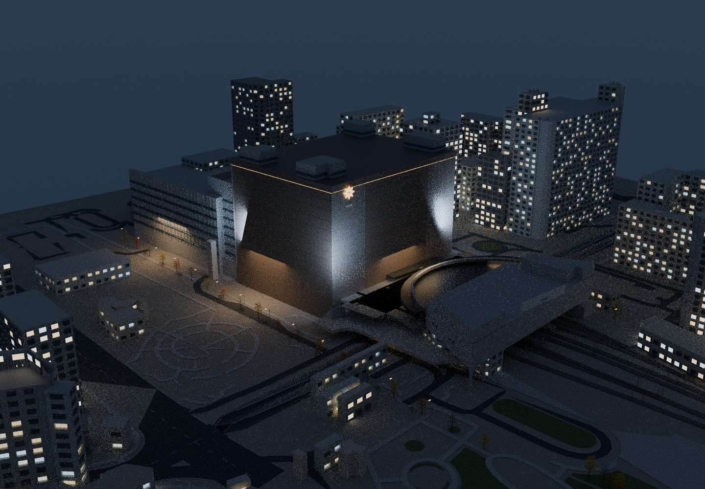
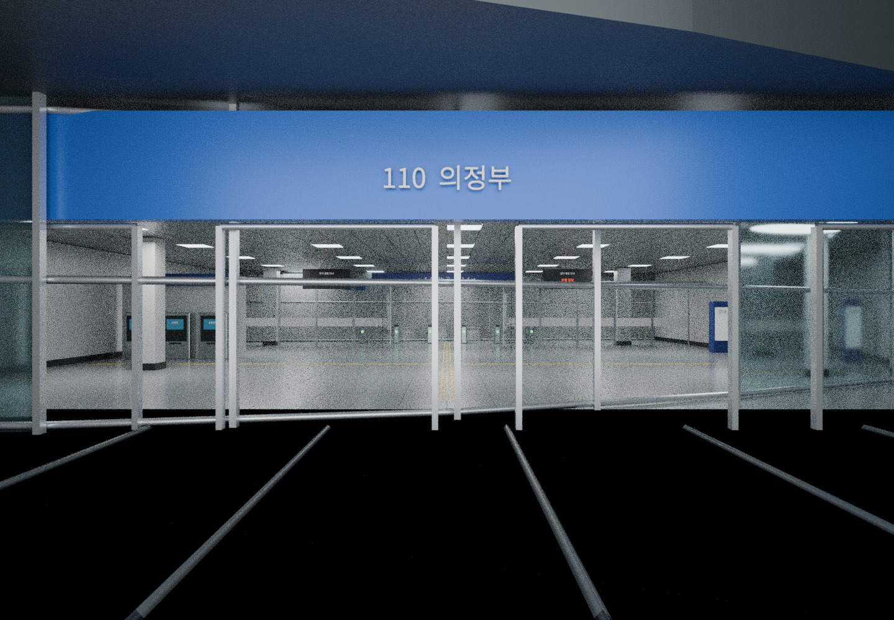
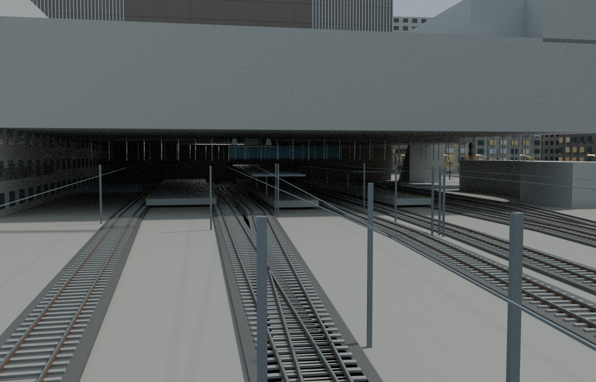

# 의정부 디지털 트윈 개발과정기

> 기록 범위: 2026년 11월 16일 밤~17일 새벽(KST), 1차 착수부터 5차 작업 및 시 전역 윤곽 생성까지. UTC로는 11월 16일에 해당한다. 이 문서는 결과를 완성품으로 포장하는 소개서가 아니라 **자료 → 가설 → 구현 → 실패 관찰 → 수정 → 검증 → 배포**의 과정 기록이다. 작성 시점에 4차는 운영 배포 검증 완료, 5차와 시 전역 확장은 생성·통합·업로드가 진행 중이다.

## 1. 출발점과 계속 바뀐 완료 기준

처음 저장소는 짧은 README만 있는 상태였다. 목표는 의정부역 일대를 Blender로 구현하고 실제 간판과 나무·단풍, 하늘과 최적화를 갖추는 것이었다. 단순 도시 매스가 아니라 사진에 가까운 장소감을 요구했으며, 구현 중에도 사용자는 여러 지점의 렌더를 보고 부족한 점을 계속 지적했다.

이 지적은 부가 요청이 아니라 모델의 구조를 바꾸는 기준이 되었다. 평면적인 도로와 비어 있는 내부, 어두운 유리, 지나치게 단순한 건물을 그대로 두고 객체 수나 테스트 성공만으로 완료를 선언하지 않기로 했다. 요구는 다음 순서로 구체화되었다.

1. 실제 역 주변 사진·지도에 기반한 외관과 무료 수목.
2. 최신 LTS와 실제 무료 에셋 확보, 반복적인 사진 보고.
3. 정적 웹과 `twin.uijeongbu.rhee.life`, GitHub main 연동 자동 배포. GitHub Actions 금지.
4. 별도 내부 보기 금지. 외관 출입구와 대합실을 한 공간으로 연결.
5. 야경·조경, 철도·승강장·전차선, 건물별 창빛과 유리 너머의 내부.
6. 사용자 화면에서 나타난 도로 줄무늬·창 잡점 등 깊이 경쟁 제거.
7. 가로등·가로수·신호등·도로명 표지판, 주변 개별 건물의 외관.
8. 의정부시 전체의 건물·도로·지형 윤곽으로 확장.
9. 개발 과정 자체를 저장소 문서로 기록하고 계속 렌더를 공유.

## 2. 근거를 다루는 원칙

자료의 종류마다 확인할 수 있는 것이 다르다. 지도 좌표는 입면과 현재 간판을 알려주지 않으며, 사진은 보이지 않는 뒷면이나 실제 층고를 확정하지 않는다. 공식 층수도 미터 단위의 높이와 같지 않다. 그래서 아래 구분을 유지한다.

|구분|사용 방식|확정하지 않는 것|
|---|---|---|
|OSM 건물·도로·시설 좌표|외곽선, 중심점, 교차로와 선형의 위치|전수성, 현행성, 측량급 정확도|
|공식 건축·건물 자료|건물 정체, 확인된 층수, 설계 형태|현재 모든 점포와 광고|
|날짜가 있는 방문사진|그 시점의 외장, 창, 출입구, 실내 마감|촬영되지 않은 방과 정확한 치수|
|과거 조경·야경 사진|빛의 성격, 벤치와 식재 유형|지금도 모든 장식물이 존재하는지|
|DEM|도시와 산지의 큰 고저차|지하차도·인도 턱·실내 층고|
|절차적 모델링|창·풀·자갈 등 반복 형상의 효율적 생성|실제 개별 물체의 정확한 수량·배치|

출처 목록과 직접 확인한 사진별 관찰은 [시각·지도 조사](../reference/RESEARCH.md)에 남긴다. 동영상 후보 링크를 찾은 것과 실제 재생하여 본 것은 구분한다. 사진 원본을 모델 참고로 읽은 것과 사진을 텍스처로 재배포한 것도 구분한다.

## 3. 1차: 역·백화점과 주변 윤곽을 세우다

OSM 직접 API에서 확보한 지도와 해안건축 공식 사진, 관광공사 공원 사진을 출발 자료로 삼았다. 높은 백화점과 낮은 역동, 깊은 곡면 캐노피, 외부 계단과 곡선 주차램프를 분리했다. 코레일 의정부역과 경전철 의정부역을 같은 장소로 합치지 않았다.

초기에는 역·백화점 22매스와 주변 약 518개 건물 객체가 만들어졌다. 그러나 이 수는 최종 도시의 건물 전수 숫자가 아니다. 이후 `building=roof` 태그를 일반 건물로 처리한 오류를 발견해 지붕 24건을 제외했고, 주변 건물 수는 494동으로 정정했다. 첫 숫자를 영구적인 성과 수치로 반복하지 않는 이유다.

낮·석양·밤 하늘을 만들고 세 시점의 렌더를 생성했다. 사용자에게 첫 이미지를 보여 주자 “사실적이지 않고 조잡하다”는 피드백이 나왔다. 이 단계는 완성된 사실 재현이 아니라 외곽과 배치를 확인하는 연구 모델이었다. 반복 핀과 창, 단순한 벽, 평면적인 지면이 실제 장소와 다른 점을 드러냈다.

## 4. 무료 수목과 환경의 확인

설치된 Blender 4.3.2에는 등록된 수목 라이브러리가 확인되지 않았다. 처음에는 자체 절차적 은행·단풍·소나무와 두 단계 LOD를 제작했다. 이는 외부에서 받은 무료 나무라고 소개하면 안 되는 자체 제작 자산이다.

사용자의 후속 지시에 따라 공식 Blender 5.2.4 LTS를 별도로 받아 체크섬과 실행을 확인했고, 기존 버전을 덮어쓰지 않았다. 동봉 brush/node 에셋과 온라인 Essentials의 존재도 구분했다. “Blender에는 무료 에셋이 없다”는 일반화 대신, 해당 설치에서 동봉된 수목 메시를 확인하지 못했다는 범위로 설명을 바로잡았다.

Poly Haven의 CC0 `Tree Small 02` 원본과 텍스처 10개를 실제 확보해 MD5를 대조했다. 이를 도시용 공유 메시와 낮은 해상도 텍스처로 정리하고 여름·가을색 파생 자산을 만들었다. 원본 식물은 Burkea africana이며, 가을색 변경은 재질 파생이다. 이것이 의정부 현장에서 확인한 단풍나무 수종이라는 뜻은 아니다.

최종 장면에 무료 외부 자산 12개 공유 인스턴스와 자체 수목이 함께 들어갔다. 원본 메시 복제 대신 공유 데이터와 재질 배치를 사용해 메모리와 객체 처리를 줄였다. 세부 수치·라이선스·재생성은 [수목 기록](TREE_ASSETS.md)을 따른다.

## 5. 2차: 사진에서 드러난 층과 공간의 오류

### 5.1 광장을 막은 가짜 건물

광장 카메라가 검게 가려지는 문제를 렌더로 발견했다. 원인은 지도에 기록된 `building=roof`와 높이 `0.01`을 일반 건물 높이 보정 규칙에 넣어 9.9m 정도의 통박스로 만든 데 있었다. 지붕 태그를 건물 몸체로 생성하지 않도록 분리하고, 잘못 뒤집힌 면법선도 교정했다.

처음에는 광장 높이를 6m로 가정했으나 주변 데크와 연결되지 않았다. 공식 자료로 확인한 것은 대합실이 3층이라는 사실이며, 11m라는 모델 값은 OSM 데크와 사진을 정합하기 위한 추정이다. 6m 가정을 취소하고 더 일관된 연결 기준을 사용했다. 과거 문서의 값은 당시 시도이고 후속 검토가 이를 대체한다.

### 5.2 시민로는 평면 도로가 아니다

2025년 방문 사진에서 중앙 지하차도와 양측 지상도로가 서로 다른 높이임을 확인했다. 실제 OSM tunnel/cutting way를 따라 경사 노면·옹벽·난간과 지면 절개를 만들었다. 지도의 `layer=-2`를 “깊이 2m”로 해석하지 않았다. 최대 깊이 5m는 여전히 사진 기반 근사다.

### 5.3 별도 내부 장면에서 단일 공간으로

사용자는 내부를 별도 보기로 두는 방식을 명확하게 거부했다. 따라서 대합실을 독립 배경처럼 보여 주지 않고 외부 출입구 뒤에 같은 좌표계로 연결했다. 대합실 사진 세 장에서 회색 타일, 금속 격자 천장, 사각등, 유리칸막이, 발권기, 점자블록, 개찰기, 계단과 양측 에스컬레이터를 관찰했다.

내부 첫 검수에서는 가정한 중앙 기둥이 점자 통로를 막고, 에스컬레이터가 바닥에 묻혔다. 기둥을 제거하고 바닥 개구부와 아래층 착지면을 수정했다. 통합 뒤 출입구를 막는 또 다른 OSM 지붕 매스를 raycast로 찾았고 얇은 슬래브로 바꾸어 외부에서 내부가 보이게 했다. 구조가 연결된다는 것과 실제 치수까지 일치한다는 것은 별개이므로 추정 변환과 층고를 문서에 남겼다.

자세한 근거: [2차 검토](V2_REVIEW.md), [내부 연구](INTERIOR.md).

## 6. 3차: 빛과 식재의 밀도를 만들다

야경에서는 백화점 코너의 차가운 루버빛과 캐노피·지하차도의 따뜻한 빛을 사진에서 구분했다. 처음 너무 어두운 야경은 보조광을 조절해 다시 렌더했다. OSM 잔디 구역 36개와 크기·색을 달리한 개별 풀잎을 추가하고 네 개 메시로 묶었다.

2018년 공원 사진에서 바닥 매입등, 원형광장 둘레 조명, 벤치·식재와 안내도를 확인했다. 과거 LED 장미나 장식물을 현재 존재하는 시설로 단정해 무작정 배치하지 않았다. 실내 대합실 사진에서는 정원·화분을 확인하지 못했으므로 “실제 내부 조경”을 지어내지는 않았다.

조명 에너지와 창의 점등은 실측값이 아니라 시각적 근사다. Blender의 area/point light가 GLB에 그대로 들어가는 것은 아니므로 웹에서의 야간 표현은 별도로 검증해야 한다. [야경·조경 기록](NIGHT_LANDSCAPE.md)에 이 차이를 명시했다.

## 7. 4차: 사용자 화면이 드러낸 깊이 경쟁

사용자가 보낸 웹 화면에는 교차로의 회백색 줄무늬와 건물 창의 검은 점이 있었다. 이는 낮은 Cycles 샘플에서 생기는 렌더 노이즈와 다르게, 도로 조각의 공면 중복과 웹 깊이 정밀도·압축 좌표 정밀도를 함께 의심해야 하는 증상이었다.

1. 원본 도로 ribbon을 단순히 여러 번 덮지 않고 평면 합집합·차집합으로 도로/보행로/연석을 분리했다.
2. 도로 표면 간 수평 겹침을 수치 검증해 약 `1.1e-15㎡` 수준으로 줄였다. 이는 해당 계산의 부동소수점 오차 수준이며 모든 장면의 모든 오류가 0이라는 뜻은 아니다.
3. Draco 위치 정밀도를 20bit로 높여 도심 전체 범위에서 얇은 창 구조가 양자화로 무너지지 않도록 했다.
4. 웹의 near/far 범위를 카메라 거리에 맞게 조절하고 reversed depth 우선·log depth fallback을 추가했다.
5. 창을 벽 앞 발광판으로 겹쳐 붙이는 대신 벽에 구멍을 내고 두께 있는 유리와 얕은 내부 공간을 만들었다.

324개 주변 건물에 창 16,459개를 생성했으며 7,263개를 야간 점등 대상으로 구성했다. 이는 실제 각 방의 위치와 점등을 조사한 결과가 아니라 불규칙 창빛을 표현하는 절차적 모델 수치다. GLB는 단일 scene을 유지했다.

철도는 실제 지도 선형을 사용해 105개 구간과 5,872개 침목을 만들었다. 여섯 플랫폼 태그를 여섯 개 섬으로 중복 해석하지 않고 세 개 섬식 영역으로 결합했다. 전철과 교외선, 경전철을 구분하며 높이·캐노피·전차선 간격은 추정으로 남겼다.

검증 파일은 [4차 통계](v4-validation.json), [깊이와 창 개선](V4_DEPTH_AND_WINDOWS.md), [철도 기록](RAIL_NOTES.md), [창빛 기록](WINDOW_LIGHTING.md)에 있다. 낮/밤/입구/철도 렌더는 다음과 같다.

## 8. 파일 전송과 배포도 검증 대상이다

큰 파일을 만들었다는 것과 저장소·운영 사이트에 반영되었다는 것은 다르다. 약 10.8MB GLB의 GitHub blob 전송이 741초 동안 응답하지 않아 중단되었고, 불변 사본의 해시를 확인한 후 다른 전송 경로로 성공했다. 사용자 승인 버튼 미클릭이 원인이었다고 확인한 것은 아니다.

4차 `.blend`는 기본 압축 18,335,088바이트에서 Zstandard level19로 10,645,347바이트로 줄였다. 해제한 전체 바이트의 SHA256가 동일했고 Blender 재열기도 통과했다. 파일 용량을 줄이기 위해 형상이나 텍스처를 삭제한 것이 아니다.

Cloudflare native Git Builds를 main에 연결하고 GitHub Actions를 만들지 않았다. 도메인 HTTP 200만으로 3D가 정상이라고 판단하지 않았다. `build.json`의 커밋과 운영 GLB의 해시·바이트 수, 단일 scene 및 대합실·철도 노드까지 확인했다.

또한 `station.glb`라는 고정 이름 때문에 브라우저가 이전 파일을 최대 한 시간 재사용하는 문제가 있었다. 배포마다 콘텐츠 해시가 들어간 모델 파일명을 생성하도록 바꾸어 새 파일을 요청하게 했다. 임시 뷰어와 Git 정적 자산 간 덮어쓰기 충돌도 Git 기반 자산으로 통합해 해결했다.

### 확인된 원격 이정표

|단계|main 커밋|기록 의미|
|---|---|---|
|1차|`9c1e4e809adcc326c7bd46a069e6d6171f035f27`|첫 외관 연구 모델, 두 부모 병합|
|2차|`2b7375a`|내외관 연결 및 지붕 가림 개선|
|3차|`f100aa7`|잔디와 야경 개선|
|웹 깊이 수정|`ebc6e08`|깊이버퍼·카메라·창빛 전환 및 캐시 대응|
|4차|`dabfadeeddb175f0a1529d4fe27b62b9f428454b`|철도·창 내부·도로 합집합 모델과 렌더 통합|

4차 실배포는 `build.json`과 main이 일치했고 `/assets/station.bdefff8f043aa1ec.glb`를 내려받아 10,783,996바이트, Git blob `1bfdc54acb6f02b397481149e4cecb7af1e4d250`과 일치함을 확인했다. 이 표는 이후 커밋이 생기더라도 당시 검증 이력을 보존한다.

클라우드 브라우저의 WebGL 비활성화와 로컬 Chromium의 socket 제한 때문에 GPU로 웹 장면을 직접 조작하는 시각 검수는 미완료였다. Cloudflare Browser Rendering도 해당 시점 할당량 제한을 반환했다. 따라서 “파일 배포 검증 완료”와 “웹의 깜빡임이 모든 기기에서 완치”를 동일하게 쓰지 않는다.

## 9. 5차: 개별 건물과 거리의 특징을 되살리다

5차는 같은 창 패턴을 모든 건물에 붙이는 것에서 벗어나 특정 사진과 주소를 대조하는 단계다.

- **역동**: 2025년 사진에서 동쪽의 흰 타일 폐쇄면과 북쪽의 긴 창띠를 구분하고, 타일 줄눈·역명판을 보강했다.
- **한화생명 사옥**: 공식 주소와 임대 자료로 특정 OSM footprint를 교차 확인했다. 공식 10층을 채택하고 갈색 커튼월, 검은 상부 띠, 확인된 옥상 글자를 별도 구현했다. 기존 공통 창과 중복 표면을 제거한다. 전체 뒤면과 실별 점등은 아직 근사다.
- **철도 바닥**: 절차적 자갈과 받침판을 추가했다. 이는 사진 자산이나 실측 체결장치가 아니라 생성한 디테일이다. UV 이미지 재질로 만들어 GLB에서도 재현되도록 했다.
- **가로시설**: OSM 가로등 28개, 신호기 노드 2개, 신호횡단 8곳, 나무 주변 그레이팅 35개를 근거 위치에 두었다. 시민로·평화로·신흥로는 지도에서 읽은 이름이고 표지의 정확한 설치 위치와 암 방향·치수는 추정이다.
- **반복 적용 검증**: 가로시설 모듈은 두 번 실행해도 같은 객체 수가 유지되도록 했다. 렌즈·표지 글자·그레이팅은 본체와 깊이를 분리해 공면 경쟁을 피한다.

[한화 외관](HANWHA_FACADE.md), [가로시설](STREET_FURNITURE.md), [5차 생성 검사](v5-validation.json)를 함께 읽는다. 5차 통합 장면은 1,790객체이며 역 타일 969개, 자갈 24,821개와 받침판 11,744개의 생성 디테일을 포함한다. 낮·밤·철도·역 타일 근접 렌더를 각각 검수했다. 작성 시점 작업 브랜치 `feat/photo-details-v5`의 `c28e6f8`까지 코드 마이크로커밋이 확인되었으며 이후 자산 업로드가 진행 중이다. 독립 모듈의 렌더 성공을 운영 배포 성공으로 확대하지 않는다.

### 5차에서 드러난 업로드 한도와 무손실 복원

5차 Blender 파일은 14,449,268바이트다. 단일 blob 요청은 실제로 HTTP 400과 요청 본문 16MiB 한도 오류를 반환했다. 원본 바이너리는 한도보다 작아 보여도 base64 인코딩 후 요청이 커진다는 점이 병목이었다. 이 경우는 앞서 원인 미확인이었던 장시간 무응답과 달리 오류 응답으로 한도를 확인했다.

형상을 깎거나 정밀도를 낮추는 대신 두 조각으로 나누어 업로드하고, `blender/v5/restore.py`가 조각별 해시와 합친 파일 해시를 검증하도록 했다. 복원된 Blender 파일의 SHA256는 `23e956af7c4e78bfdaef413893a7331b582537aa389791c80434c6185d762521`이다. 기존 루트의 4차 Blender 파일은 그대로 두고 최신 5차의 위치와 복원 방법을 별도로 안내한다.

웹 GLB는 14,548,736바이트에서 gzip 8,115,543바이트로 무손실 압축해 전달하고, 웹 빌드 단계에서 다시 푼다. `npm run build` 후 복원 GLB의 SHA256 `fde1fd20970937032f92c31d6a4b0fff40db4f52aad43a8b83826e8478d4e696`이 원본과 같음을 확인했다. 저장·전송 형식과 런타임 형식을 구분한 해결이다. 이 시점의 성공은 파일 업로드와 로컬 빌드 검증이며, 최종 main 병합과 운영 자산의 재다운로드 검증은 별도 단계다.

## 10. 의정부시 전체 윤곽으로 확장

역 주변 상세만으로는 시 전체를 조망할 수 없다는 요청에 따라, 행정경계 relation `2409183`과 실제 고도 데이터를 확보했다. 한 번의 지도 API 요청은 노드 한도에 걸려 20개 구역으로 나누어 받고 way ID로 중복 제거했다.

생성 manifest의 첫 확인 수치는 건물 9,094개, 도로 9,721개 OSM way, 지형 12,759개 셀, 268개 타일·레이어 배치다. 건물 높이 직접 태그는 1,910개이며 나머지 7,184개는 층수 또는 용도별 기본값을 사용한다. “9,721개 도로”는 서로 다른 도로명 9,721개를 뜻하지 않는다.

원점은 역 장면과 같은 경도 127.046, 위도 37.738, 동쪽 x/북쪽 y이다. 지형은 Tilezen/Mapzen Terrain Tiles의 HGT를 80m 메시로 재샘플링했다. 산악 지형과 도시 전체의 큰 높낮이를 위한 것이며 지표 턱이나 역 층고의 측량자료가 아니다. 기존 역 상세 부지는 중복 생성하지 않고 비워 두었다. 중앙의 사각 빈 영역은 결합 자리이지 조사에서 빠뜨린 도심으로 숨기려는 것이 아니다.

첫 컬러 검수에서 도로가 지형에 묻힌 부분을 발견했다. 입력 고도 샘플과 80m 삼각 지형의 보간이 달라 생긴 문제여서, 도로 높이를 렌더 지형의 삼각 보간 기준으로 다시 맞추고 0.65m 시각 오프셋을 주는 수정을 완료했다. 최신 컬러 렌더에서 도로가 이어지는 것을 확인했다. 이 오프셋은 실제 도로가 지면보다 항상 0.65m 높다는 뜻이 아니다. 타일은 1km·레이어별로 나누고 원경에는 윤곽 모델을, 역 근처에는 상세 모델을 사용한다. 모든 타일을 최초 접속 때 한꺼번에 불러오지 않는 방향으로 웹 최적화를 설계한다.

이 단계는 **행정경계 안에 기록된 지도 기반 도시 윤곽**이다. 누락된 건물은 나타나지 않고, 행정경계는 객체 중심 분류라 지적도 수준 절단과 다르며, 고가도로의 모든 층 관계도 아직 구현하지 않았다. 작성 시점 104개의 GLB 타일, 합계 약 4MB를 내보냈다. 전체 윤곽은 로컬 생성·렌더 및 타일 내보내기 단계이며 역 상세와의 웹 통합·배포 완료로 기록하지 않는다.

## 11. 최적화에서 지킨 것과 아직 측정하지 않은 것

시각 개선과 최적화는 서로 반대가 아니라 표현 방식의 문제였다. 반복되는 형상을 재질별 배치로 묶고, 나무는 메시를 공유하며, 보이지 않는 파일 복제와 불필요한 객체 처리를 줄였다. 대량 오브젝트 삭제 병목은 개별 삭제 대신 일괄 처리로 바꿨다.

초기 장면은 12,779객체에서 2,076객체로 줄었고, 이후 조경을 더한 장면은 2,375객체, 4차는 1,754객체였다. 단계마다 기능과 geometry가 다르므로 이 숫자는 동일 장면 FPS 비교가 아니다. 4차 GLB는 1개 scene, 1,645노드, 1,564메시였고 Blender 객체 수와 GLB 메시 수를 혼용하지 않는다.

입체 방과 창·철도 디테일을 추가하면 파일이 커질 수 있다. 작은 파일이라는 이유만으로 필요한 형상을 삭제하지 않고 먼저 무손실 압축과 배치·공유를 사용한다. 실측하지 않은 FPS, 모바일 프레임시간, 메모리 수치를 좋은 숫자로 지어 쓰지 않는다.

## 12. 다음 완료 기준과 남은 일

- [x] 원본 사진과 지도 출처를 남기고 사실/추정을 구분한다.
- [x] 내외관을 한 scene으로 연결하고 출입구 시야를 렌더로 확인한다.
- [x] 4차 모델의 main no-ff와 native Cloudflare 자동 배포, 운영 파일 해시를 확인한다.
- [x] 도로 표면 중복을 수치 계산으로 줄이고 렌더에서 이전 줄무늬 개선을 확인한다.
- [ ] 다양한 실제 GPU·모바일 환경에서 움직이며 깊이 경쟁·투명 정렬을 검증한다.
- [ ] 5차와 시 전체 타일의 최종 main/운영 반영을 각각 확인한다.
- [ ] 현행 간판 전수, 주변 건물 개별 외장과 치수, 역사 내부의 전체 배치를 더 확인한다.
- [ ] 역 상세 지면과 광역 DEM의 경계, 고가도로 층 관계, 도로 침수·매몰·떠 있음 문제를 더 검수한다.
- [ ] 광원·내부 공간·도로시설의 실제 배치와 시각적 근사를 구분하면서 정교하게 만든다.

## 13. 기록을 계속 갱신하는 방법

새 단계는 `요청/근거 → 변경 → 발견한 오류 → 검증 → 커밋 → 배포 → 남은 점` 순서로 추가한다. 이전 실패와 가정은 삭제하지 않고 후속 수정이 무엇을 대체했는지 적는다. 모델러의 검사 결과, 실제 렌더, 원격 파일 해시, 운영 접속 결과는 서로 다른 증거로 보존한다. 사진 보고는 진척을 보여 주는 수단이며 정확도를 과장하는 장식이 아니다.

개발은 계속된다. 현재까지의 성과는 장소를 닮은 장면을 재현 가능한 코드와 자료로 바꾸어 가는 과정이며, 아직 조잡한 부분을 정확히 발견하고 고치는 것 자체가 핵심 작업이다.

## 14. 5차 실배포와 6차 도시 윤곽 스트리밍

5차는 `c936240bf64c7efa5b01dcb7f7a334024f55e845`에서 main으로 병합했다. 운영 도메인의 `build.json`이 동일 커밋을 보고했고, 실제 내려받은 `station.fde1fd2097093703.glb`는 14,548,736바이트 및 SHA256 `fde1fd20970937032f92c31d6a4b0fff40db4f52aad43a8b83826e8478d4e696`로 로컬 원본과 일치했다. 이는 gzip 보관→Cloudflare 네이티브 빌드 복원→콘텐츠 해시 URL 배포가 실제 동작했다는 증거이다. 루트 Blender는 v4 호환본이고 최신 v5는 `blender/v5/restore.py`가 분할 보존본을 검증해 복원한다.

6차는 역 모델을 다른 화면으로 바꾸는 것이 아니라 동일 좌표계에 도시 윤곽 타일을 덧붙이는 방식이다. 지상 시점은 가까운 32~48개 타일만 유지하고, 높은 도시 조망에서는 전체 타일을 순차 로드한다. 동시 디코딩은 두 개로 제한하며 범위를 벗어난 geometry/material을 해제한다. 외곽 타일에는 사진 질감·실제 간판·개별 외장이 없으므로 정밀 역 모델과 구분해 '윤곽'으로 표시했다. 104개 타일은 약4MB로 전체를 단일 거대 GLB로 다시 만들지 않았다.

QA 중 요청시 렌더와 350ms 갱신 제한을 함께 쓰면 사용자가 짧게 이동하고 멈췄을 때 마지막 타일 선택이 갱신되지 않는 문제가 발견됐다. 거리 계산은 104개뿐이므로 시간 제한을 제거하고 렌더 시점마다 평가하도록 고쳤다. WebGL 생성 실패 뒤 도시 보기 버튼을 눌렀을 때의 null 접근도 막았다. 순간 네트워크 오류가 영구 실패로 남지 않도록 2초·4초 백오프와 총3회 한도를 추가했다. 모의 로더 시험은 동시 요청2개 이하, 지상 거주 상한, 이동 후 dispose, 높은 조망 전체 로드를 확인했다. 이는 실제 모바일 GPU의 프레임레이트 측정과는 다르다.

통합 Blender 렌더를 별도로 생성하여 역과 외곽 윤곽이 같은 공간에 놓이는지 직접 확인했다. 이 과정에서 80m 지형 셀의 중심점만으로 역 영역을 제외하면 경계에 수십 미터 겹침/공백이 생길 수 있음을 발견했다. 정확한 역 경계 사각형으로 지형·도로를 잘라내는 후속 보정을 진행한다. 정밀 지면과 SRTM 고도 사이의 150m 전이는 실측 지형이 아닌 연결 근사이며, 도시 도로의 고가·지하 층 분리는 아직 별도 과제다.

브라우저 시험 환경은 GL_VENDOR/RENDERER가 Disabled로 노출되어 실제 WebGL GPU 렌더가 불가능했다. 대체 이미지와 실패 상태 처리는 확인했으나 실제 기기에서의 GPU 미관 검증 완료라고 기록하지 않는다. 이후 운영 반영은 main 커밋, build.json, 타일 원본 해시를 별도로 검증해 기록한다.

타일 업로드104회는 연결 도구 지연 때문에 비효율적이었다. 런타임 pack/Range 로더를 추가하는 대신, USTAR+gzip 아카이브 하나를 보관하고 기존 Cloudflare 빌드에서104개의 독립 GLB를 복원하도록 했다. 이는 런타임 서버 Range 지원 여부에 의존하지 않으며 경로허용목록·GLB헤더·manifest길이·SHA를 빌드시검증한다. 실제 타일 AABB가 격자중심에서2.5km까지 늘어나는 예도 발견하여 고정800m여유 대신 실제외접반경을 로드범위에 사용하도록 수정했다.

경계 검수는 선언된 crop 숫자만 믿지 않았다. 기존 역 모델 생성기를 다시 확인하니 바닥 박스는 중심(45,55), 크기660×610m로 실제 범위가 x[-285,375], y[-250,360]였다. 도로·건물crop보다20~25m넓으므로 도시 지형을 이전crop만큼만 빼면 공면 경쟁이 남는다. 지형 제외범위를 실제 바닥 범위로 분리하고 도로·건물의 지도crop은 기존대로 유지하도록 수정했다. 바닥/지도/타일 경계는 같은 값이라고 가정하지 않는 것이 핵심이었다.

### 6차 운영 확인 마감

`48d6946f2a189a6acaf984d4b70f4d45f9093551`에서 main no-ff 병합했다. Cloudflare의 push_event/main 네이티브 빌드는 success였고, 실 도메인의 build.json도 동일 커밋이었다. 운영 manifest SHA256은 `ba97461940058ceb7e55d8e5e30ee282961260ad00e098eac26b9d4cf28454f3`로 로컬과 같았다. 총3,988,628바이트의104개 타일을 전부 실제 내려받아 각각 manifest SHA와 일치함을 확인했다. 첫 검사24개는 연결 타임아웃이었으며 동시성을8에서4로낮춘재시도에서104/104완료·실패0이되었다. 이것을모델파일오류로오인하지않고전송장애와해시검증을구분했다.

다음 모델 갱신 때 구버전 타일이 브라우저 캐시에 남지 않도록 manifest는 재검증 요청하고, 각 타일 URL에는 해당 SHA256의 앞16자를 버전 쿼리로 붙인다. 도시 Blender 원본과 OSM 원자료 아카이브도 저장소에 보존했다. 실제 GPU 프레임레이트·모바일 미관 검수와 최신 상가 외관 완성은 여전히 별도 과제로 남는다.

## 15. 7차 서부 접근 구조와 떠 있는 면 보수

2025년 서부광장 사진과 OSM 770806011/14/15/18/19/21/22를 대조하여 서남·북측 하부 접근과 상부 접근, 중간참, 가는 회녹색 골조, 유리 캐노피·난간을 구성했다. 정확한 위치를 확인하지 못한 택시쉼터와 포켓쉼터 가구는 사진이 있다는 이유만으로 임의 배치하지 않았다. 계단 수 태그와 방향은 자료 기반이지만, 6.72/11m 높이와 폭은 근사로 기록했다.

첫 검수에서 기존에 대략 배치했던 서측 직선 계단이 새 접근과 중복되어 공중에 남았다. 이름이 있는 객체를 지워도 기존 재질 batch에 포함된 계단 면은 남았기 때문에, 원생성 코드의 x=-49 계단 범위에 완전히 들어간 면만 골라 제거했다. 관련 없는 건물 전체나 보행면을 지우지는 않았다. 새 부품 269개는 재질별 5개 batch로 합치고 법선·유리 두께를 보강해 웹 부하를 줄였다.

종이 쐐기처럼 보이는 지면도 별도로 검사했다. 서측 1,676개 수평면 중 5개 planar ring이 퇴화해 있었다. 기존 도로·보도는 높이만 있는 평면이라 가장자리가 공중 카드처럼 보이는 문제도 있었다. XY 지도 윤곽은 유지한 채 중복 정점과 극소면을 정리하고, 경계에 지면까지 이어지는 수직 측면을 넣었다. 이후 1,665개 서측 수평면 검사에서 invalid ring 0개를 확인했다. 원래 데이터에 있는 각진 윤곽까지 사진과 같아졌다는 뜻은 아니다.

기존 광장 가로등 또한 11m 데크에 대해 기둥이 6~11m로 기록되어 데크 아래에 매달린 것을 원코드에서 확인했다. 동일한 XY 위치를 유지하고 데크 위 11.05~15.05m로 수정했다. 조명 높이는 사진 정밀 측량이 아니라 현재 데크에 대한 구조 정합 근사이다. 처음 선택한 카메라가 주변 건물 속에 들어가 검은 렌더를 만든 실패는 실제 이미지를 열어 확인했다. 가림을 없애기 위해 건물을 지우지 않고 검증된 서측 카메라로 이동했다.

### 7차 원격 반영과 남은 검증

main `937b1ed7`에서 GitHub Actions 없이 Cloudflare 네이티브 빌드 성공을 확인했다. 실제 도메인의 14,655,520바이트 모델을 다시 다운로드했고 SHA256 `58120faaf7f52baf7a3b954202ab6a6cb144f92196bb4db60ee943c5ad481fd9`가 원본과 같았다. 최신 Blender는 `blender/v7`의 두 파트를 복원하는 방식이며 재열기 1,793개 오브젝트 검사를 통과했다.

서부 검사 영역의 불량 평면 링은 5개에서 0개로 줄었다. 다만 전체 도로 검사에서 동쪽 x=201.76..236.70에 수직 경계면 1쌍 중복이 남은 것을 정확히 찾았다. 면적 약 3.63㎡이며 이번 서부 접근 렌더 범위와 별개다. 다음 미세 수정 대상으로 남기며 전체 공면 오류가 0이라고 보고하지 않는다. 주변 일반 건물의 외관은 아직 단순화되어 있고 정확한 위치가 확인되지 않은 택시쉼터와 포켓 가구는 임의로 놓지 않았다. 브라우저 GPU가 비활성화된 검사 환경이라 실제 GPU 프레임률 검증은 수행했다고 주장하지 않는다.

### 7차 경계면 후속 수정

동쪽 아스팔트의 동일 정점 집합 수직 경계면 한 장(약 3.63㎡)만 제거했다. 고유 도로 면이나 XY 윤곽은 변경하지 않았다. 저장 후 Blender를 다시 열어 전체 Union surface 객체에서 동일 정점 집합 중복을 재검사했고 0개였다. 이 검사는 다른 객체 사이의 모든 가능한 겹침이나 시각적 오류가 전부 없다는 뜻은 아니다. GLB를 다시 내보내고 Blender 원본 분할 해시도 갱신했다.

## 16. 서측 사진의 구조적 세부를 반영한 8차 개선

2014년 진입구 사진과 2025년 서측 넓은 사진을 다시 대조했다. 7차에서는 진입 지붕이 처음부터 경사였고 횡방향 프레임만 존재했으나, 실제 사진에는 낮은 입구의 수평 유리 처마와 원형 주기둥, 지붕 세로 격자가 보인다. 이를 기존 OSM 기반 접근 위치 위에 보강했다. 새 시설 위치를 임의로 만들지 않았다. 닫힌 경사 석재 측벽과 줄눈을 추가했고 123개 제작 객체를 4개 재질 메시로 합쳤다. 유리는 두께 12mm 모델링 근사로 보강했고 법선을 재계산했다.

같은 비교 카메라에서 낮과 밤을 직접 렌더하고 검수했다. 사진에 보이지 않는 택시쉼터의 위치나 가구를 추정 배치하지 않았다. 2014년 사진의 세부 재질이 현재도 완전히 같다는 사실은 확인하지 않았고, 2025년 전체 사진에서 확인되는 구조 연속성과 구별해 기록했다.

### 창이 벽 밖으로 튀어나오던 두 가지 원인

동쪽 비교 렌더에서 창과 실내 박스가 벽 밖으로 돌출된 것을 직접 확인했다. 원인은 단순 재질 문제가 아니었다. OSM 외곽선의 시계·반시계 방향이 혼재해 일부 건물의 법선이 안쪽을 향했고, 동일한 -0.9m 방 깊이 적용이 실외로 향했다. 493개 footprint를 확인하고 그중 220개의 방향을 교정했다.

1차 교정 후에도 중앙 건물 일부가 돌출되어 다시 검수했다. 폭 약 0.01~0.2m인 얇은 건물 조각에 0.9m 방을 무조건 생성해 반대편 벽을 뚫는 별도 원인이 있었다. 셀별 세 지점에서 footprint 안쪽 두께를 확인해 그 45% 이하로 깊이를 제한하고, 너무 얇은 36개 셀에서는 벽을 보존하고 가짜 방을 만들지 않게 했다. 건물 전체 삭제나 색 덮기로 감추지 않았다.

결과는 319개 건물의 16,135개 절차적 창이다. 이전 16,459개 통계에는 이미 별도 외관으로 바뀐 한화생명 288개 창이 남아 있었기 때문에 숫자 차이를 단순 누락으로 해석하면 안 된다. 한화생명 개별 외관은 보존했다. 비교 렌더에서 중앙과 우측 돌출이 사라진 것을 확인했으나 실제 창 위치·방 배치·점등 현황을 측량했다는 뜻은 아니다. 새 빌드도 수정 생성기를 호출하도록 연결해 재발을 방지했다.
